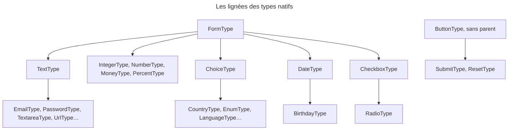

## Objectif

Reconnaître les types fournis par Symfony, choisir le bon, et savoir de qui
chacun hérite — c'est la lignée, pas la famille, qui décide du rendu.

## Avant la règle : le problème à résoudre

Un form d'inscription a besoin d'un âge, d'un pays, d'un password saisi
deux fois et d'un bouton « Enregistrer ». Écrire un type pour chacun serait
absurde : Symfony en fournit une quarantaine.

Deux questions se posent alors :

- **lequel choisir** pour chaque field ;
- **comment il se comporte** quand on le personnalise — et là, la famille
  sous laquelle la documentation le range peut tromper.

## Le fil rouge : l'inscription

```php
$builder
    ->add('age', IntegerType::class)
    ->add('country', CountryType::class)
    ->add('plainPassword', RepeatedType::class, ['type' => PasswordType::class])
    ->add('save', SubmitType::class);
```

Quatre types, quatre lignées différentes : `FormType`, `ChoiceType`,
`FormType` (avec deux `PasswordType` dedans), et `ButtonType`.

## Le cycle complet en un schéma



## Le catalogue

| Famille (documentation) | Types |
|---|---|
| **Texte** | `TextType`, `TextareaType`, `EmailType`, `IntegerType`, `MoneyType`, `NumberType`, `PasswordType`, `PercentType`, `SearchType`, `UrlType`, `RangeType`, `TelType`, `ColorType` |
| **Choix** | `ChoiceType`, `EnumType`, `CountryType`, `LanguageType`, `LocaleType`, `TimezoneType`, `CurrencyType` |
| **Date et heure** | `DateType`, `DateTimeType`, `TimeType`, `DateIntervalType`, `BirthdayType`, `WeekType` |
| **Autres** | `CheckboxType`, `RadioType`, `FileType` |
| **UID** | `UuidType`, `UlidType` |
| **Groups** | `CollectionType`, `RepeatedType` |
| **Caché** | `HiddenType` |
| **Boutons** | `ButtonType`, `ResetType`, `SubmitType` |
| **Base** | `FormType` |

Les types UID exigent le component Uid. Exécuté sans lui : le form se
construit et se rend, puis la submission lève une `Error`, class `Uuid`
introuvable.

## Limites de périmètre

Deux entrées du catalogue officiel sortent du périmètre de l'examen
(`docs/syllabus/exclusions.yml`) : `EntityType`, qui relève de l'intégration
avec une base de données, et les fields Symfony UX.

## Une famille n'est pas une lignée

Les familles rangent la documentation ; `getParent()` décide de l'inheritance.
Relevé par exécution sur les 38 types de `symfony/form` 8.0.15 :

| Parent | Types |
|---|---|
| `TextType` | `EmailType`, `PasswordType`, `TextareaType`, `SearchType`, `UrlType`, `TelType`, `ColorType`, `RangeType` |
| `FormType` | `TextType`, `IntegerType`, `NumberType`, `MoneyType`, `PercentType`, `ChoiceType`, `DateType`, `CheckboxType`, `CollectionType`, `RepeatedType`, `FileType`, `HiddenType`… |
| `ChoiceType` | `CountryType`, `LanguageType`, `LocaleType`, `TimezoneType`, `CurrencyType`, `EnumType` |
| `DateType` | `BirthdayType` |
| `CheckboxType` | `RadioType` |
| `ButtonType` | `SubmitType`, `ResetType` |
| aucun | `FormType`, `ButtonType` |

Les quatre types numériques sont rangés sous « texte » mais n'héritent **pas**
de `TextType`. Exécuté : un block `text_widget` personnalisé change le rendu d'un
`TextType`, et laisse intact un `IntegerType`, rendu en
`<input type="number">`.

## La famille des choix

`ChoiceType` est le parent des six autres : leurs options sont les siennes. Ses
trois options structurantes sont `choices`, `multiple` et `expanded`. Rendu
réel :

| `multiple` | `expanded` | Rendu |
|---|---|---|
| `false` | `false` | `<select>` |
| `false` | `true` | radio buttons |
| `true` | `false` | `<select multiple>` |
| `true` | `true` | checkboxes |

Dans `choices`, la **key est le libellé**, la **valeur est la donnée**. Exécuté
avec `['France' => 'fr']` : soumettre `fr` donne la donnée `'fr'` ; soumettre
`France` rend le form invalide, « The selected choice is invalid. ».

`EnumType` exige l'option `class` : sans elle, `MissingOptionsException`
(« The required option "class" is missing. ») ; avec une enum `Suit`,
soumettre `h` donne `Suit::Hearts` (exécuté).

## `RepeatedType`

Il crée **deux enfants**, `first` et `second` par défaut, du type donné par
l'option `type`. Exécuté : si les valeurs coïncident, la donnée est **une seule
valeur** ; sinon le form est invalide avec « The values do not match. », et la
donnée du field répété est `null`.

**Où apparaît l'erreur ?** `RepeatedType` la pose sur lui-même, mais
l'extension Validator — active dès que le Validator est installé, donc dans une
application complète — redirige les erreurs vers le premier enfant par
`error_mapping` (`RepeatedTypeValidatorExtension`, « Map errors to the first
field »). Exécuté : avec cette extension, l'erreur est sur `first` ; avec
`'error_mapping' => []`, elle revient sur le field répété.

## Les boutons

`ButtonType` n'a **pas de parent** : les boutons ne descendent pas de
`FormType`. Exécuté, avec une type extension visant `FormType` : elle
s'applique au field texte, **pas** au `SubmitType`, dont les préfixes de block
sont `["button", "submit", …]`.

Un bouton s'ajoute comme un field, mais c'est un `SubmitButton` : il ne porte
pas de donnée — absent de `getData()` — et `isClicked()` dit s'il a servi à
soumettre. Exécuté avec deux boutons : seul celui envoyé vaut `true`, et
`getClickedButton()` le rend.

## Concrètement dans ton application

- Un nombre : `IntegerType` ou `NumberType` — et un theme qui vise
  `integer_widget`, pas `text_widget`.
- Une liste fixe : `ChoiceType` avec `choices` libellé ⇒ valeur ; un pays, une
  langue : les types spécialisés, qui sont des `ChoiceType`.
- Une enum PHP : `EnumType`, avec `class`.
- Un password à confirmer : `RepeatedType` avec `type: PasswordType::class`
  — l'erreur s'affiche sous le premier field.
- Deux actions sur un même form : deux `SubmitType`, et `isClicked()`.

## À comprendre

- **Pourquoi `IntegerType` n'hérite-t-il pas de `TextType` ?** Parce qu'il a
  son propre widget (`type="number"`) et ses propres transformers : seule la
  documentation le range sous « texte ».
- **Pourquoi les keys de `choices` sont-elles les libellés ?** Parce qu'un
  libellé est unique à l'affichage, alors que plusieurs libellés pourraient
  partager une valeur.
- **Pourquoi un bouton n'est-il pas un `FormType` ?** Parce qu'il n'a ni donnée
  ni validation : il ne fait que dire quelle action a été choisie.

## À mémoriser

- Famille documentaire ≠ parent ; `IntegerType` hérite de `FormType`.
- Toute la famille des choix hérite de `ChoiceType`.
- `multiple` × `expanded` : quatre rendus ; `choices` : libellé ⇒ valeur.
- `EnumType` : `class` obligatoire.
- `RepeatedType` : `first`, `second`, une donnée ; erreur sur `first` avec
  l'extension Validator.
- `ButtonType` sans parent ; un bouton n'a pas de donnée.
- `EntityType` et Symfony UX hors périmètre.
- Moyen mnémotechnique : **« La famille range, le parent décide »**.

## Pièges d'examen

**La famille « texte » n'est pas la lignée de `TextType`** : les types
numériques héritent directement de `FormType`.

**Toute la famille des choix hérite de `ChoiceType`.**

**Les keys de `choices` sont les libellés.**

**Un bouton n'est pas un `FormType`** : une extension de `FormType` ne le
touche pas.

**`RepeatedType` rend deux fields mais une seule donnée.**

**L'erreur « The values do not match. » s'affiche sur `first`** dans une
application complète : l'extension Validator l'y redirige.

## Application : trois scénarios

**Scénario 1 — Le theme qui oublie l'âge.** Un `text_widget` personnalisé
habille tous les fields « texte », sauf `age`. *Solution.* `IntegerType`
hérite de `FormType` et a son propre `integer_widget` : le personnaliser aussi.

**Scénario 2 — Le choix toujours refusé.** Un `ChoiceType` déclare
`['fr' => 'France']`, et le client API envoie `France`. *Solution.* Inverser :
la key est le libellé, la valeur est la donnée — `['France' => 'fr']`, et le
client envoie `fr`.

**Scénario 3 — Le message d'erreur mal placé.** Le template affiche les erreurs
de `plainPassword` au-dessus des deux fields, et « The values do not match. »
n'apparaît jamais. *Solution.* L'erreur est sur `plainPassword.first` : afficher
`form_errors(form.plainPassword.first)`, ou rendre les deux enfants par
`form_row()`.

## QCM d'entraînement

Six questions sur les types natifs. Choisis avant d'ouvrir la correction.

**Question 1.** La documentation range `IntegerType` dans la famille « texte ». Quel est son parent, selon `getParent()` ?

- **A.** `TextType`, comme sa famille
- **B.** `NumberType`, le type numérique général
- **C.** `FormType`
- **D.** Aucun : les types numériques sont autonomes

<details>
<summary>Correction</summary>

**Bonne réponse : C.** Relevé sur Form 8.0.15 : `IntegerType`, `NumberType`,
`MoneyType` et `PercentType` héritent directement de `FormType`.

A est le piège : la famille documentaire n'est pas la lignée. B et D sont faux.

</details>

**Question 2.** Un `ChoiceType` déclare `'choices' => ['France' => 'fr']`. On soumet la valeur `France`. Résultat ?

- **A.** Le form est invalide
- **B.** La donnée vaut `'fr'` : le libellé est traduit en valeur
- **C.** La donnée vaut `'France'`
- **D.** Une exception : une key ne se soumet pas

<details>
<summary>Correction</summary>

**Bonne réponse : A.** La key est le libellé ; seule la valeur `fr` est un
choix soumis valide (exécuté : « The selected choice is invalid. »).

B suppose une translation du libellé. C et D inventent des comportements.

</details>

**Question 3.** Une type extension vise `FormType::class` et ajoute un attribute à chaque type étendu. Le form contient un `TextType` et un `SubmitType`. Lesquels sont touchés ?

- **A.** Les deux : tout type descend de `FormType`
- **B.** Aucun : une extension vise un type exact
- **C.** Le seul `SubmitType`
- **D.** Le seul `TextType`

<details>
<summary>Correction</summary>

**Bonne réponse : D.** `SubmitType` descend de `ButtonType`, qui n'a pas de
parent (exécuté).

A est le piège. B : une extension s'applique aussi aux descendants du type
visé. C inverse.

</details>

**Question 4.** Dans une application complète, avec le Validator installé, un `RepeatedType` nommé `pw` reçoit deux valeurs différentes. Sur quel form l'erreur « The values do not match. » est-elle attachée ?

- **A.** Sur `pw` lui-même
- **B.** Sur `pw.first`
- **C.** Sur le form racine
- **D.** Sur `pw.second`, le field de confirmation

<details>
<summary>Correction</summary>

**Bonne réponse : B.** `RepeatedTypeValidatorExtension` fixe `error_mapping` à
`['.' => first_name]` (exécuté).

A est le cas **sans** extension Validator, ou avec `error_mapping: []`. C et D
sont faux.

</details>

**Question 5.** Un form a deux boutons, `save` et `publish`. Le navigateur envoie `save`. Que contient `getData()` du form, et que vaut `$form->get('publish')->isClicked()` ?

- **A.** Les seuls fields de données, et `false`
- **B.** Les fields plus `save`, et `false`
- **C.** Les fields plus les deux boutons, et `true`
- **D.** Les seuls fields, et une exception : `publish` n'a pas été soumis

<details>
<summary>Correction</summary>

**Bonne réponse : A.** Un bouton ne porte pas de donnée ; seul le bouton envoyé
répond `true` à `isClicked()` (exécuté).

B et C mettent des boutons dans la donnée. D invente une exception.

</details>

**Question 6.** Un développeur écrit `->add('suit', EnumType::class)`, sans autre option. Que se passe-t-il ?

- **A.** Le type devine l'enum depuis la property `suit`
- **B.** Une `MissingOptionsException`
- **C.** Un `ChoiceType` vide est rendu
- **D.** Une erreur seulement à la submission

<details>
<summary>Correction</summary>

**Bonne réponse : B.** Exécuté : « The required option "class" is missing. ».

A invente une devinette. C et D supposent que le type se construit.

</details>

## Fiche express

**Si tu dois retenir seulement 7 choses :**

- **La famille range, le parent décide** : `IntegerType` → `FormType`.
- Famille des choix : **tous enfants de `ChoiceType`**.
- `multiple` × `expanded` : **select, radio, select multiple, checkbox**.
- `choices` : **libellé ⇒ valeur** ; on soumet la valeur.
- `EnumType` : **`class` obligatoire**.
- `RepeatedType` : **deux fields, une donnée** ; erreur sur **`first`** avec
  le Validator.
- **`ButtonType` sans parent** ; un bouton n'a pas de donnée, `isClicked()`.

**En une phrase, pour tout reconstruire :**

```text
famille (doc) ≠ getParent() ; ChoiceType → pays, langue, enum… ; choices = [libellé => valeur]
  ; RepeatedType = first + second → 1 donnée ; ButtonType hors de FormType
```

## Sources officielles

- [Form Types Reference](https://github.com/symfony/symfony-docs/blob/8.0/reference/forms/types.rst)
- [Form 8.0, `ChoiceType`](https://github.com/symfony/symfony/blob/8.0/src/Symfony/Component/Form/Extension/Core/Type/ChoiceType.php), [`RepeatedType`](https://github.com/symfony/symfony/blob/8.0/src/Symfony/Component/Form/Extension/Core/Type/RepeatedType.php) et [`ButtonType`](https://github.com/symfony/symfony/blob/8.0/src/Symfony/Component/Form/Extension/Core/Type/ButtonType.php)
- [Form 8.0, `RepeatedTypeValidatorExtension`](https://github.com/symfony/symfony/blob/8.0/src/Symfony/Component/Form/Extension/Validator/Type/RepeatedTypeValidatorExtension.php)
