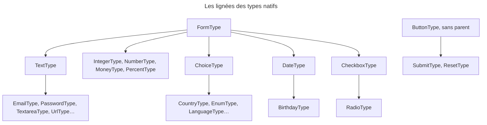

## Objectif

Reconnaître les types fournis par Symfony, choisir le bon, et savoir de qui
chacun hérite — c'est la lignée, pas la famille, qui décide du rendu.

## L'essentiel

Symfony fournit une quarantaine de types, rangés par **familles** dans la
documentation. Mais c'est la **lignée** — `getParent()` — qui décide du rendu
et des extensions : les types numériques, rangés sous « texte », n'héritent
pas de `TextType`, et les boutons ne descendent pas de `FormType`.

## Le schéma



## L'exemple : l'inscription

```php
$builder
    ->add('age', IntegerType::class)                                           // parent : FormType
    ->add('country', CountryType::class)                                       // parent : ChoiceType
    ->add('plainPassword', RepeatedType::class, ['type' => PasswordType::class]) // deux enfants
    ->add('save', SubmitType::class);                                          // parent : ButtonType
```

## Le catalogue

| Famille (documentation) | Types |
|---|---|
| **Texte** | `TextType`, `TextareaType`, `EmailType`, `IntegerType`, `MoneyType`, `NumberType`, `PasswordType`, `PercentType`, `SearchType`, `UrlType`, `RangeType`, `TelType`, `ColorType` |
| **Choix** | `ChoiceType`, `EnumType`, `CountryType`, `LanguageType`, `LocaleType`, `TimezoneType`, `CurrencyType` |
| **Date et heure** | `DateType`, `DateTimeType`, `TimeType`, `DateIntervalType`, `BirthdayType`, `WeekType` |
| **Autres** | `CheckboxType`, `RadioType`, `FileType` |
| **UID** | `UuidType`, `UlidType` |
| **Groups** | `CollectionType`, `RepeatedType` |
| **Caché** | `HiddenType` |
| **Boutons** | `ButtonType`, `ResetType`, `SubmitType` |
| **Base** | `FormType` |

Les types UID exigent le component Uid : sans lui, la submission lève une
`Error`.

## Limites de périmètre

`EntityType`, qui relève de la base de données, et les fields Symfony UX
sortent du périmètre de l'examen.

## Une famille n'est pas une lignée

| Parent | Types |
|---|---|
| `TextType` | `EmailType`, `PasswordType`, `TextareaType`, `SearchType`, `UrlType`, `TelType`, `ColorType`, `RangeType` |
| `FormType` | `TextType`, `IntegerType`, `NumberType`, `MoneyType`, `PercentType`, `ChoiceType`, `DateType`, `CheckboxType`, `RepeatedType`… |
| `ChoiceType` | `CountryType`, `LanguageType`, `LocaleType`, `TimezoneType`, `CurrencyType`, `EnumType` |
| `DateType` / `CheckboxType` | `BirthdayType` / `RadioType` |
| `ButtonType` | `SubmitType`, `ResetType` |

Seuls `FormType` et `ButtonType` n'ont pas de parent. Un `text_widget`
personnalisé laisse donc intact un `IntegerType`, rendu en
`<input type="number">`.

## La famille des choix

| `multiple` | `expanded` | Rendu |
|---|---|---|
| `false` | `false` | `<select>` |
| `false` | `true` | radio buttons |
| `true` | `false` | `<select multiple>` |
| `true` | `true` | checkboxes |

- Dans `choices`, la **key est le libellé**, la **valeur est la donnée** :
  avec `['France' => 'fr']`, soumettre `France` donne « The selected choice is
  invalid. ».
- `EnumType` exige l'option `class` : sans elle, `MissingOptionsException`.

## `RepeatedType`

Deux enfants, `first` et `second`, du type donné par `type`. Valeurs égales :
**une seule donnée**. Sinon : « The values do not match. », et la donnée vaut
`null`. Dans une application complète, `RepeatedTypeValidatorExtension`
redirige cette erreur vers **`first`** par `error_mapping`.

## Les boutons

`ButtonType` n'a pas de parent : une extension de `FormType` ne touche pas un
`SubmitType`. Un bouton est un `SubmitButton` : absent de `getData()`, et
`isClicked()` dit s'il a servi ; `getClickedButton()` le rend.

## Pièges d'examen

**La famille « texte » n'est pas la lignée de `TextType`** : les types
numériques héritent directement de `FormType`.

**Toute la famille des choix hérite de `ChoiceType`.**

**Les keys de `choices` sont les libellés.**

**Un bouton n'est pas un `FormType`** : une extension de `FormType` ne le
touche pas.

**`RepeatedType` rend deux fields mais une seule donnée.**

**L'erreur « The values do not match. » s'affiche sur `first`** dans une
application complète : l'extension Validator l'y redirige.

## Application

- Un theme `text_widget` qui oublie l'âge → `IntegerType` hérite de
  `FormType` : personnaliser aussi `integer_widget`.
- « The values do not match. » jamais affiché →
  `form_errors(form.plainPassword.first)`.

## QCM d'entraînement

**Question 1.** La documentation range `IntegerType` dans la famille
« texte ». Quel est son parent, selon `getParent()` ?

- **A.** `TextType`, comme sa famille
- **B.** `NumberType`, le type numérique général
- **C.** `FormType`
- **D.** Aucun : il est autonome

<details>
<summary>Correction</summary>

**Bonne réponse : C.** Les quatre types numériques héritent directement de
`FormType` ; leur famille ne range que la documentation.

</details>

**Question 2.** Une type extension vise `FormType::class` et ajoute un
attribute. Le form contient un `TextType` et un `SubmitType`. Lesquels sont
touchés ?

- **A.** Les deux : tout descend de `FormType`
- **B.** Le `TextType` seulement
- **C.** Le `SubmitType` seulement
- **D.** Aucun : il faut viser chaque type

<details>
<summary>Correction</summary>

**Bonne réponse : B.** `SubmitType` descend de `ButtonType`, qui n'a pas de
parent : une extension de `FormType` ne l'atteint pas.

</details>

**Question 3.** Dans une application complète, un `RepeatedType` nommé `pw`
reçoit deux valeurs différentes. Sur quel form l'erreur « The values do not
match. » est-elle posée ?

- **A.** Sur `pw`, le field répété
- **B.** Sur `pw.second`, la confirmation
- **C.** Sur le form racine
- **D.** Sur `pw.first`

<details>
<summary>Correction</summary>

**Bonne réponse : D.** `RepeatedTypeValidatorExtension` la redirige vers le
premier enfant par `error_mapping` ; vide, elle revient sur `pw`.

</details>

**Question 4.** Un développeur écrit `->add('suit', EnumType::class)`, sans
autre option. Que se passe-t-il ?

- **A.** Une `MissingOptionsException`
- **B.** Un `<select>` vide
- **C.** L'enum est devinée d'après la property
- **D.** Un `TextType` à la place

<details>
<summary>Correction</summary>

**Bonne réponse : A.** `EnumType` exige l'option `class` : « The required
option "class" is missing. ».

</details>

## Fiche express

**Si tu dois retenir seulement 6 choses :**

- **Famille ≠ lignée** : les types numériques héritent de `FormType`.
- Toute la famille des choix hérite de **`ChoiceType`**.
- `multiple` / `expanded` : select, radio, select multiple, checkboxes.
- `choices` : **key = libellé**, valeur = donnée.
- `RepeatedType` : deux fields, **une donnée** ; erreur sur **`first`**.
- Boutons : **`ButtonType`**, sans parent ; hors de `getData()`.

Moyen mnémotechnique : **« La famille range, le parent décide »**.

## Sources officielles

- [Form Types Reference](https://github.com/symfony/symfony-docs/blob/8.0/reference/forms/types.rst)
- [Form 8.0, `ChoiceType`](https://github.com/symfony/symfony/blob/8.0/src/Symfony/Component/Form/Extension/Core/Type/ChoiceType.php), [`RepeatedType`](https://github.com/symfony/symfony/blob/8.0/src/Symfony/Component/Form/Extension/Core/Type/RepeatedType.php) et [`ButtonType`](https://github.com/symfony/symfony/blob/8.0/src/Symfony/Component/Form/Extension/Core/Type/ButtonType.php)
- [Form 8.0, `RepeatedTypeValidatorExtension`](https://github.com/symfony/symfony/blob/8.0/src/Symfony/Component/Form/Extension/Validator/Type/RepeatedTypeValidatorExtension.php)

