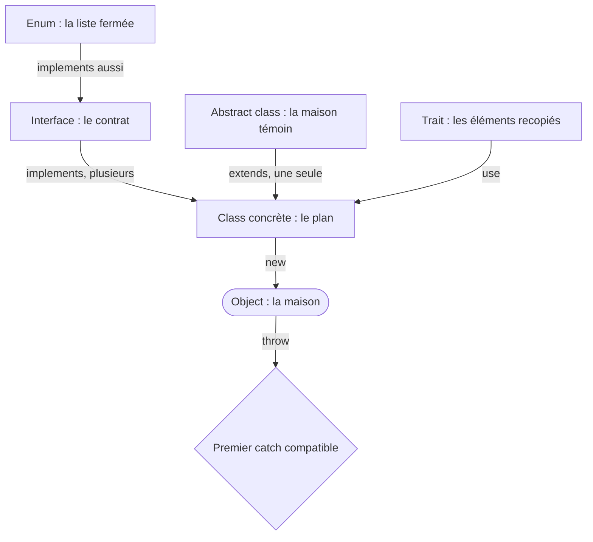

## En une phrase

Le PHP object sert à fabriquer des objects à partir de plans, à leur fixer des
règles de contrat, à partager du code entre eux, et à réagir quand quelque
chose tourne mal — avec la syntaxe de PHP 8.4, que Symfony 8.0 exige.

## L'image de la vie réelle

Pense à un **chantier de maisons**. La **class** est le plan d'architecte,
l'**object** est la maison construite d'après ce plan. Une **interface** est une
norme, comme la prise électrique : tout appareil qui la respecte se branche.
Une **abstract class** est une maison témoin à finir : les murs sont là, chaque
acheteur termine les pièces. Un **trait** est une caisse d'éléments
préfabriqués qu'on recopie dans plusieurs plans. Une **enum** est la liste
fermée des couleurs de façade autorisées. Une **closure** est un ouvrier qu'on
envoie avec ses propres outils. Un **attribute** est un autocollant posé sur un
carton : il ne fait rien tant que personne ne le lit. Et les **exceptions**
sont les alarmes du chantier.

## Le schéma

## Notion par notion

### PHP API up to PHP 8.4 version

**C'est quoi ?** Ce que le langage sait faire, version par version, de PHP 8.0
à 8.4. Symfony 8.0 exige PHP 8.4, donc sa syntaxe est au programme.

**Dans la vraie vie** Comme les modèles d'une voiture : il faut savoir quelle
option est arrivée avec quelle année, pour ne pas chercher le régulateur sur un
modèle qui ne l'avait pas encore.

**Pour l'examen** Date chaque nouveauté : les enums et `readonly` en 8.1,
`#[\Override]` en 8.3, les property hooks et `private(set)` en 8.4. Avec
`array_merge()`, c'est l'array de droite qui gagne ; avec `+`, celui de
gauche.

### Object Oriented Programming

**C'est quoi ?** Les règles de base des objects : la visibilité (`public`,
`protected`, `private`), la promotion des parameters du constructor,
`readonly`, et la différence entre `self` et `static`.

**Dans la vraie vie** Un passe-partout `private` ouvre toutes les maisons du même plan,
pas seulement la tienne : la visibilité se décide au niveau du plan.

**Pour l'examen** `self` désigne la class où le code est écrit, `static` la
class réellement appelée. `readonly` interdit de réaffecter une property, mais
l'object qu'elle contient reste modifiable.

### Attributes

**C'est quoi ?** Des métadonnées écrites `#[…]` au-dessus d'une class, d'une
method ou d'une property ; une class marquée `#[Attribute]` les définit.

**Dans la vraie vie** L'autocollant « Fragile » sur un carton : le carton ne
devient pas plus solide. Il faut un livreur qui le lise et agisse.

**Pour l'examen** Un attribute ne fait rien tout seul : il est lu par
réflexion. `getAttributes()` rend des descriptions, et c'est `newInstance()`
qui construit l'object — et qui signale les erreurs.

### Interfaces

**C'est quoi ?** Un contrat : une liste de methods publiques, sans corps, que
toute class qui l'implémente doit fournir. Depuis PHP 8.4, une interface peut
aussi exiger des properties.

**Dans la vraie vie** La prise électrique normalisée : le fabricant du grille-pain
fait ce qu'il veut à l'intérieur, tant que la prise est la bonne.

**Pour l'examen** Une class implémente plusieurs interfaces. Une constant
d'interface se redéfinit depuis PHP 8.1, sauf si elle est `final`. Une property
`readonly` ne satisfait pas une exigence d'écriture (`set`).

### Anonymous functions and closures

**C'est quoi ?** Des functions sans nom, rangées dans une variable ou passées en
argument. Deux syntaxes : `function () use ($x)` et la function fléchée
`fn () =>`.

**Dans la vraie vie** Un ouvrier qu'on envoie sur un autre chantier avec une
photo du plan : s'il emporte une photo (`use`), le plan peut changer ensuite,
lui garde l'ancienne version.

**Pour l'examen** `use ($x)` copie la valeur au moment où la closure est
définie ; `use (&$x)` partage la variable. `fn` capture tout seul, toujours
par valeur, et ne contient qu'une expression.

### Abstract classes

**C'est quoi ?** Une class qu'on ne peut pas instancier, qui partage du code
avec ses filles et leur impose des methods à écrire.

**Dans la vraie vie** La maison témoin livrée sans cuisine : on ne peut pas y
habiter telle quelle, chaque acheteur doit poser sa cuisine.

**Pour l'examen** Une method abstraite n'est jamais `private` : la fille ne
pourrait pas l'écrire. On n'étend qu'une seule class. Retiens la règle : une
interface décrit un contrat, une abstract class partage du code.

### Exception and error handling

**C'est quoi ?** Le mécanisme pour signaler un problème (`throw`) et le
rattraper (`try`, `catch`, `finally`). Tout ce qui se lance implémente
`Throwable`.

**Dans la vraie vie** Deux alarmes différentes : l'alarme incendie du
bâtiment (`Error`, un problème de l'engine PHP) et l'alerte du chef de chantier
(`Exception`, un problème métier). Un détecteur réglé sur l'une n'entend pas
l'autre.

**Pour l'examen** `Error` et `Exception` sont deux branches sœurs : un
`catch (Exception)` laisse passer une `Error`. Le premier `catch` compatible
gagne, et `finally` s'exécute même après un `return`.

### Traits

**C'est quoi ?** Un ensemble de methods et de properties recopié dans une class
avec `use`, sans créer de type ni de parent.

**Dans la vraie vie** Une caisse d'éléments préfabriqués : on recopie le même
escalier dans plusieurs plans, mais aucune maison ne « devient » un escalier.

**Pour l'examen** L'ordre de priority surprend : la class gagne sur le trait,
qui gagne sur la class parente. Deux traits qui apportent la même method
provoquent une erreur fatale, sauf si `insteadof` choisit.

### Enums

**C'est quoi ?** Un type qui n'accepte qu'une liste fermée de cas. Une enum
adossée donne à chaque cas une valeur `int` ou `string`.

**Dans la vraie vie** Les couleurs d'un feu tricolore : rouge, orange, vert, et
rien d'autre. On ne fabrique pas un quatrième feu avec `new`.

**Pour l'examen** `from()` lève une erreur si la valeur ne correspond à aucun
cas, `tryFrom()` rend `null`. Une enum porte des methods et des constants,
mais aucun état : pas de property d'instance, pas de constructor.

## Les erreurs de débutant

- Croire qu'un `catch (Exception)` attrape tout : les `Error` passent à côté.
- Penser qu'un attribute agit seul, sans code qui le lit.
- Croire que `readonly` rend un object entièrement figé.
- Attendre du trait qu'il l'emporte sur la method écrite dans la class.
- Utiliser `from()` sur une valeur venue du user, au lieu de
  `tryFrom()`.

## La fiche du lot

- **Class** = plan, **object** = maison.
- **Interface** = contrat ; **abstract class** = code partagé, une seule par
  class.
- Priority : **class > trait > parent**.
- **`self`** = où le code est écrit, **`static`** = qui est appelé.
- **`use ($x)`** copie à la definition ; **`fn`** capture par valeur.
- **`from()`** lève, **`tryFrom()`** rend `null`.
- **`Error`** et **`Exception`** sont sœurs ; **`Throwable`** attrape tout.
- Un **attribute** est inerte sans lecteur.
