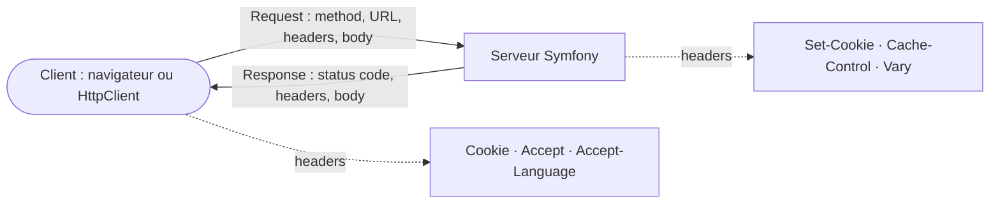

## En une phrase

HTTP, c'est la conversation entre un navigateur et un serveur : le client
envoie une Request, le serveur renvoie une Response avec un status code, et
quelques headers règlent le reste — cookies, cache, langue et format.

## L'image de la vie réelle

Imagine un **restaurant**. Tu es le client, le serveur note ce que tu veux et
la cuisine prépare le plat. Ce que tu demandes, c'est la **Request** : ce que tu veux
(l'URL), ce que tu fais (la method : lire la carte, commander, annuler) et tes
préférences (« sans gluten », « en français »). Le plat qui revient, c'est la
**Response**, avec un petit mot du serveur : le **status code** (« voilà »,
« c'est à la table d'à côté », « ce plat n'existe pas », « la cuisine a un
problème »). La carte de fidélité qu'on te rend à chaque visite, c'est le
**cookie**. Les plats déjà prêts au comptoir, c'est le **cache**. Et le livre de
règles que tous les restaurants suivent, c'est la **RFC 9110**.

## Le schéma

## Notion par notion

### HTTP Specification (RFC 9110)

**C'est quoi ?** Le document officiel qui dit ce que **veulent dire** les
methods, les status codes et les headers, quelle que soit la version d'HTTP.

**Dans la vraie vie** C'est le code de la route : il est le même pour une
voiture neuve ou ancienne. Le cache a son propre code (RFC 9111) et chaque
« modèle de voiture » — HTTP/1.1, HTTP/2, HTTP/3 — a sa notice (9112, 9113,
9114).

**Pour l'examen** Ne confonds pas la **ressource** (la chose, le plat du jour)
et sa **représentation** (la version servie : en photo, en texte, en anglais).
Les noms de headers ne tiennent pas compte de la casse.

### Status codes

**C'est quoi ?** Le nombre à trois chiffres qui résume le résultat. Le
**premier chiffre** donne la famille : 2 réussi, 3 aller ailleurs, 4 erreur du
client, 5 erreur du serveur.

**Dans la vraie vie** À l'entrée d'une boîte de nuit, « vous n'êtes pas sur la
liste, qui êtes-vous ? » est un **401** ; « je sais qui vous êtes, mais vous
n'entrez pas » est un **403**.

**Pour l'examen** 401 = authentication, 403 = authorization. 307 et 308 gardent
la method, 303 force un `GET`, et 204 n'a jamais de body.

### HTTP request

**C'est quoi ?** L'object `Request` de Symfony : tout ce que le client a
envoyé, rangé dans des **sacs** — `query` pour l'URL, `request` pour le body
POST, `cookies`, `headers`, `attributes` pour les données de l'application.

**Dans la vraie vie** Un bordereau de livraison avec des cases séparées : le plat, les
options, l'adresse de livraison. On lit la bonne case, on ne fouille pas tout
le bon.

**Pour l'examen** `Request::get()` n'existe plus en 8.0 : on nomme toujours le
sac. L'adresse IP et le `Host` viennent du client et peuvent mentir. Pour
l'IP, Symfony ignore les headers de proxy tant qu'aucun proxy n'est déclaré de
confiance ; pour le `Host`, une liste vide ne contrôle rien.

### HTTP response

**C'est quoi ?** L'object `Response` : un status code, des headers et un body.
Le controller la **rend** ; c'est Symfony qui l'envoie, une seule fois.

**Dans la vraie vie** Le cuisinier pose le plat sur le comptoir ; c'est le
serveur qui l'apporte à la table. Le cuisinier ne court pas en salle.

**Pour l'examen** `isOk()` veut dire 200 exactement, `isSuccessful()` toute la
famille 2xx. `isRedirection()` couvre les 3xx, alors que `isRedirect()` suit sa
propre liste : elle contient 201 et ne contient pas 304.

### HTTP methods

**C'est quoi ?** Le verbe de la Request : `GET` lit, `POST` crée, `PUT`
remplace, `PATCH` modifie en partie, `DELETE` supprime.

**Dans la vraie vie** Regarder la vitrine ne change rien au magasin : c'est
**sûr**. Appuyer trois fois sur le bouton de l'ascenseur donne le même résultat
qu'une fois : c'est **idempotent**.

**Pour l'examen** Toute method sûre est idempotente, jamais l'inverse : `PUT` et
`DELETE` sont idempotents sans être sûrs, `POST` et `PATCH` ne sont ni l'un ni
l'autre. Pour les methods cacheables, la RFC et Symfony ne donnent pas la même
liste : lis toujours de qui parle la question.

### Cookies

**C'est quoi ?** Une petite donnée que le serveur confie au navigateur, qui la
renvoie à chaque Request. On la lit dans la Request, on l'écrit dans la
Response.

**Dans la vraie vie** Le ticket du vestiaire : on te le donne une fois, tu le
montres à chaque passage, et il ne vaut que pour ce vestiaire-là.

**Pour l'examen** `Cookie::create()` met des défauts sûrs : `HttpOnly` contre le
vol par script, `SameSite=Lax` contre les attaques CSRF, `Secure` pour HTTPS.
Pour effacer un cookie, il faut redonner les **mêmes** `path` et `domain`.

### Caching

**C'est quoi ?** Garder une copie d'une Response pour ne pas la refaire. Deux
façons : l'**expiration** (« bon jusqu'à ») et la **validation** (« est-ce
toujours bon ? », Response `304`).

**Dans la vraie vie** Le yaourt du frigo : soit tu lis la date limite
(expiration), soit tu demandes à quelqu'un s'il est encore bon avant de le
manger (validation).

**Pour l'examen** Par défaut, une Response Symfony est `private` : rien
n'entre dans un cache partagé sans `public`. `setSharedMaxAge()` la rend
publique, `setMaxAge()` non. `no-store` interdit de garder, `no-cache` oblige
à revérifier.

### Content negotiation

**C'est quoi ?** Une même ressource existe en plusieurs formats ; le client dit
ce qu'il préfère avec les headers `Accept`, le serveur choisit.

**Dans la vraie vie** Au guichet, tu demandes ton billet « par e-mail de
préférence, sinon sur papier ». Le guichetier choisit parmi ce qu'il sait
faire, et te dit ce qu'il t'a donné.

**Pour l'examen** Chaque préférence a un poids `q`, qui vaut 1 par défaut ;
`q=0` veut dire « surtout pas ». Le serveur qui négocie doit l'annoncer avec
`Vary`, et répond `406` si rien ne convient.

### Language detection

**C'est quoi ?** Le navigateur annonce ses langues dans `Accept-Language`, avec
des poids. Symfony sait les lire et choisir parmi les langues de
l'application.

**Dans la vraie vie** Le serveur du restaurant entend ton accent et te tend la
carte en français, s'il en a une ; sinon, il prend la première carte qu'il a.

**Pour l'examen** `getLanguages()` rend la liste triée, au format `fr_FR`.
`getPreferredLanguage()` ne négocie vraiment que si tu lui donnes la liste des
langues de l'application. Là aussi, il faut `Vary`.

### Symfony HttpClient component

**C'est quoi ?** Le component pour qu'**une application Symfony appelle
d'autres serveurs** : elle devient le client.

**Dans la vraie vie** Tu fais trois achats en ligne d'un coup, puis tu
attends les colis. Tu ne restes pas bloqué devant la porte après le premier
achat.

**Pour l'examen** `request()` ne bloque pas : la Request part, et l'on attend
seulement quand on lit la Response. Un statut d'erreur lève une exception à la
lecture, sauf `getStatusCode()` ; une Response jamais lue lève à sa
destruction.

## Les erreurs de débutant

- Croire que `401` et `403` sont la même chose : l'un demande qui tu es,
  l'autre te refuse en sachant qui tu es.
- Chercher les données avec `Request::get()` : en 8.0, on passe par le sac.
- Penser qu'un `304` est un redirect parce qu'il commence par 3 : pour
  `isRedirect()`, il n'en est pas une.
- Croire qu'une method idempotente est forcément sûre : `DELETE` prouve le
  contraire.
- Mettre une Response en cache partagé sans la rendre `public`.

## La fiche du lot

- **Request** = ce que tu demandes, **Response** = le plat, **status code** = le mot du
  serveur.
- Le **premier chiffre** du status code donne la famille.
- **401** qui es-tu ? **403** pas toi.
- **Sûre** ⊂ **idempotente** ; `PUT`, `DELETE` idempotents, `POST` rien.
- Cookie sûr : **`HttpOnly`**, **`SameSite`**, **`Secure`**.
- Cache : **expiration** ou **validation** ; défaut **`private`**.
- Négocier format ou langue impose **`Vary`**.
- HttpClient : **lancer tout, lire après**.
