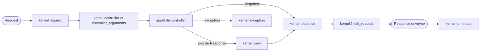

## En une phrase

Symfony est un ensemble de briques indépendantes, assemblées par un kernel qui
transforme chaque Request en Response à travers une suite d'events, et livré
selon des règles stables : licence, calendrier, compatibilité, conventions.

## L'image de la vie réelle

Imagine un **aéroport**. Le passager entre, passe une suite de contrôles et
finit dans son avion : c'est le trajet d'une **Request** jusqu'à la
**Response**. À chaque contrôle, des agents inscrits à l'avance font leur
travail : ce sont les **listeners** des events du kernel. Les boutiques sont
indépendantes et pourraient ouvrir ailleurs : ce sont les **components**. Les
convertisseurs de prises entre pays sont les **bridges**, et la direction qui
installe chaque boutique dans le terminal est le **bundle**. Seul le hall est
ouvert au public (`public/`), seuls les bureaux du personnel reçoivent des
écritures (`var/`). Et l'aéroport publie ses horaires des mois à l'avance :
c'est le calendrier des versions.

## Le schéma

## Notion par notion

### HttpFoundation component

**C'est quoi ?** Le component qui remplace les variables globales de PHP
(`$_GET`, `$_POST`…) par deux objects, `Request` et `Response`.

**Dans la vraie vie** Au lieu de lire des papiers épars sur un bureau, le
passager présente une carte d'embarquement unique, toujours au même format.

**Pour l'examen** Le component est autonome : le framework dépend de lui, pas
l'inverse. Un service qui a besoin de la Request en cours passe par
`RequestStack`, jamais par la Request directement.

### Symfony Flex

**C'est quoi ?** Un plugin Composer : il modifie ce que font `composer require`,
`update` et `remove`, en appliquant des recipes de configuration.

**Dans la vraie vie** Le livreur qui, en plus d'apporter la machine à laver, la
branche et la règle. Tu n'appelles pas le livreur : il vient avec l'achat de
l'appareil.

**Pour l'examen** Trois mécanismes : l'alias (un nom court), la recipe (la
configuration) et le pack (un package de packages). Les recipes appliquées sont
notées dans `symfony.lock`, qu'on committe.

### License

**C'est quoi ?** Symfony est publié sous licence MIT, au nom de Fabien
Potencier.

**Dans la vraie vie** Une chanson libre de droits : tu peux la jouer, la modifier,
la chanter dans un spectacle payant, à condition de citer son auteur.

**Pour l'examen** Tout usage est permis, commercial et propriétaire compris. La
seule obligation : reproduire l'avis de copyright et le texte de la licence.
Rien n'oblige à publier son propre code.

### Components and Bridges

**C'est quoi ?** Trois mots, trois roles : le component est une bibliothèque
autonome, le bridge relie un component à une bibliothèque tierce, le bundle
branche le tout dans le framework.

**Dans la vraie vie** La boutique (component), le convertisseur de prise entre deux
pays (bridge), et la direction de l'aéroport qui installe la boutique et lui
donne l'électricité (bundle).

**Pour l'examen** Un bridge seul n'enregistre aucun service : c'est le bundle
qui configure. Un component s'utilise aussi hors de Symfony.

### Code organization

**C'est quoi ?** L'arborescence par défaut d'une application : `src/`,
`config/`, `templates/`, `public/`, `var/`…

**Dans la vraie vie** Le plan de l'aéroport : un seul hall ouvert aux
voyageurs, et des bureaux où seul le personnel écrit.

**Pour l'examen** `public/` est le seul directory servi par le serveur web,
`var/` le seul où l'application écrit. Un file de `config/packages/<env>/`
ne vaut que pour cet environment.

### Request handling

**C'est quoi ?** Le cycle complet d'une Request dans le kernel : une method,
`handle()`, qui rend une Response en dispatchant une suite d'events.

**Dans la vraie vie** Les contrôles successifs de l'aéroport : à chacun, des
agents interviennent ; l'un d'eux peut te faire embarquer plus tôt, mais tu
passes quand même la porte finale.

**Pour l'examen** `kernel.view` n'a lieu que si le controller ne rend pas une
Response. Si un listener de `kernel.request` fournit directement une Response,
`kernel.response`, `kernel.finish_request` et `kernel.terminate` ont quand
même lieu.

### Exception handling

**C'est quoi ?** Ce qui se passe quand une exception n'est pas rattrapée : elle
devient l'event `kernel.exception`, et Symfony construit une page d'erreur.

**Dans la vraie vie** Le bureau des incidents : un agent peut régler le
problème lui-même, ou le transformer en autre chose, sinon on te remet une
fiche d'incident standard.

**Pour l'examen** Un listener peut fournir une Response ou remplacer
l'exception. Une Response qui porte déjà un statut d'erreur ou de redirect
le garde ; sinon le statut vient de l'exception si elle implémente
`HttpExceptionInterface`, et vaut 500 autrement. Pour rendre 200 ou 204, il
faut l'autoriser explicitement.

### Event dispatcher and kernel events

**C'est quoi ?** Le système qui annonce un event et appelle les listeners
inscrits, du plus prioritaire au moins prioritaire.

**Dans la vraie vie** L'annonce au haut-parleur : seuls ceux qui attendent ce
vol réagissent, et le personnel prioritaire passe en premier.

**Pour l'examen** Une priority haute passe tôt, la default value est 0.
Listener et subscriber ne diffèrent que par qui déclare l'inscription.
`stopPropagation()` n'arrête que les listeners restants du même event.

### Official best practices

**C'est quoi ?** Le document *Symfony Best Practices* : trente recommandations
en dix sections, pour une application classique.

**Dans la vraie vie** Le guide « bien voyager » de l'aéroport : utile,
recommandé, mais personne ne t'arrête si tu ne le suis pas.

**Pour l'examen** Ce ne sont pas des règles du framework. Les recommandations
qui surprennent : pas de bundle pour le code de l'application, une constant
pour un réglage qui ne change presque jamais, des URL écrites en dur dans les
functional tests.

### Backward compatibility promise

**C'est quoi ?** La promesse de ne pas casser ton code entre deux versions
mineures : seule une version majeure peut le faire.

**Dans la vraie vie** Une prise électrique qui reste la même pendant des années
: on peut ajouter des prises nouvelles, mais l'ancienne continue de marcher.

**Pour l'examen** La promesse dépend de la façon dont on utilise le code :
utiliser, implémenter ou étendre. Le code marqué `@internal` en est exclu, et
les named arguments ne sont couverts que pour les constructors d'attribute.

### Deprecations best practices

**C'est quoi ?** Comment annoncer qu'une API va disparaître, en la gardant
fonctionnelle et en indiquant son remplaçant.

**Dans la vraie vie** Le panneau « Cette porte fermera l'an prochain, utilisez
la porte B » : la porte marche encore, mais tu sais où aller.

**Pour l'examen** Une version mineure prévient, la majeure suivante supprime.
On marque le code avec `@deprecated` pour le lecteur et `trigger_deprecation()`
pour l'exécution. Rien ne naît déprécié.

### Framework overloading

**C'est quoi ?** Les façons de modifier un bundle tiers sans toucher à son code
: chaque sous-système a la sienne.

**Dans la vraie vie** Une boutique franchisée dans l'aéroport : tu peux changer
la vitrine, ajouter un produit, mais certaines règles de la marque ne se
modifient pas.

**Pour l'examen** Un template se surcharge dans `templates/bundles/<NomDuBundle>/`
; un service se décore ; un form type reçoit une extension. Une constraint de
validation s'ajoute, elle ne se remplace pas. Une route qu'on ne veut pas, on
ne l'importe simplement pas.

### Release management and roadmap schedule

**C'est quoi ?** Le calendrier fixe des versions de Symfony : il suit le temps,
pas le contenu.

**Dans la vraie vie** Les horaires d'une compagnie aérienne, publiés à
l'avance : l'avion part à l'heure, même si un passager n'est pas prêt.

**Pour l'examen** Un correctif chaque mois environ, une mineure tous les six
mois (mai et novembre), une majeure tous les deux ans. La dernière mineure
d'une branche, X.4, est la LTS. Symfony 8.0 a les fonctionnalités de 7.4, moins
ce qui était déprécié.

### Framework interoperability and PSRs

**C'est quoi ?** Les standards communs du PHP-FIG (les PSR), pour que des
bibliothèques de projets différents se comprennent.

**Dans la vraie vie** Les normes internationales de l'aviation : un avion d'une
compagnie peut atterrir dans n'importe quel aéroport qui les respecte.

**Pour l'examen** Symfony fournit le code de plusieurs PSR — le logger (PSR-3),
le container (PSR-11), l'event dispatcher (PSR-14) — et suit les conventions
PSR-4 et PSR-12. Pour PSR-7, il passe par un bridge.

### Naming conventions

**C'est quoi ?** Les règles d'écriture des noms dans le code et la
configuration de Symfony.

**Dans la vraie vie** La signalétique de l'aéroport : mêmes couleurs, mêmes
pictogrammes partout, pour qu'on s'y retrouve sans réfléchir.

**Pour l'examen** `camelCase` dans le code, `snake_case` dans la configuration,
les routes et les templates. `Abstract` se met devant le nom, `Interface`,
`Trait` et `Exception` derrière. Un cas d'enum s'écrit en `UpperCamelCase`.

## Les erreurs de débutant

- Croire que les best practices sont obligatoires : rien ne casse si on les
  ignore.
- Injecter la Request dans un service, au lieu de `RequestStack`.
- Croire que `kernel.view` a toujours lieu.
- Penser qu'une version mineure peut retirer une fonctionnalité dépréciée.
- Vouloir remplacer une constraint de validation d'un bundle tiers : on ne peut
  qu'en ajouter.

## La fiche du lot

- **Component** autonome, **bridge** vers un tiers, **bundle** qui configure.
- **Flex** = plugin Composer : alias, recipe, pack, `symfony.lock`.
- **MIT** : tout usage permis, garder les avis.
- **`public/`** servi, **`var/`** écrit.
- Kernel : **events**, `kernel.view` seulement sans Response.
- Priority **haute = tôt** ; `stopPropagation()` = cet event seulement.
- **Mineure prévient, majeure supprime** ; X.4 = LTS.
- **`camelCase`** code, **`snake_case`** config.
