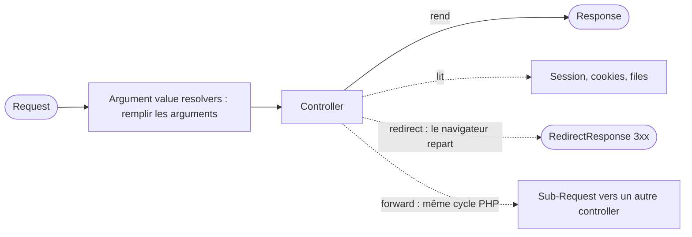

## En une phrase

Un controller est une function qui reçoit la Request et rend une Response ;
autour de lui, Symfony prépare ses arguments, garde la mémoire du visiteur
(cookies, session, flash messages) et sait rediriger, déléguer ou signaler une
page introuvable.

## L'image de la vie réelle

Imagine la **réception d'un hôtel**. Le client arrive avec une demande : c'est
la **Request**. Le réceptionniste, c'est le **controller** : il traite la
demande et rend quelque chose — une carte magnétique, un plan, un refus — c'est la
**Response**. Un assistant prépare les fiches avant qu'il les lise : ce sont les
**argument value resolvers**. Le bracelet que l'hôtel te remet, c'est le
**cookie** ; ton dossier gardé à l'accueil pendant le séjour, c'est la
**session** ; le post-it « votre taxi est réservé », lu une fois puis jeté,
c'est le **flash message**. « Allez au guichet B » est une **redirect** ;
quand le réceptionniste appelle lui-même le guichet B et te transmet ce
qu'il apprend sans que tu bouges, c'est un **forward**.

## Le schéma

## Notion par notion

### HttpKernel component and FrameworkBundle

**C'est quoi ?** Le component HttpKernel contient l'engine — le contrat
`handle()`, la class `Kernel`, les events, les resolvers. FrameworkBundle le
câble dans une application.

**Dans la vraie vie** Le bâtiment de l'hôtel (le component) et la direction qui
branche l'électricité, recrute le personnel et fixe les règles (le bundle).

**Pour l'examen** Une question tranche : est-ce que ça marche sans service
container ? Oui, c'est le component. `AbstractController` et `MicroKernelTrait`
viennent de FrameworkBundle.

### Naming conventions

**C'est quoi ?** Les habitudes de nommage des controllers : suffixe
`Controller`, class de base, pas de suffixe `Action`.

**Dans la vraie vie** Les badges du personnel portent souvent nom et poste,
mais ce n'est pas obligatoire ; seul le numéro de badge doit être unique.

**Pour l'examen** Une seule obligation : un route name unique. Le reste n'est
que convention. Quand le nom est omis, Symfony le génère à partir de la class
et de la method.

### The base AbstractController class

**C'est quoi ?** Une class de base optionnelle qui offre des raccourcis :
`render()`, `redirectToRoute()`, `json()`, `addFlash()`…

**Dans la vraie vie** La boîte à outils du réceptionniste : pratique, mais un
réceptionniste sans boîte à outils peut quand même travailler.

**Pour l'examen** Un controller est n'importe quel callable. Les raccourcis
sont `protected`. La class reçoit un locator de quelques services, pas tout le
container ; si un service manque, le raccourci échoue au moment de l'appel.

### The request

**C'est quoi ?** Comment un controller obtient la Request : en typant un
argument `Request`.

**Dans la vraie vie** Le client remet sa fiche au réceptionniste. Un employé
d'un autre service, lui, consulte le registre des demandes en cours.

**Pour l'examen** Un controller type `Request` ; un service passe par
`RequestStack`. Les parameters de route arrivent par les attributes de la
Request, puis par le nom de l'argument. `getPayload()` lit le body : un form
l'emporte sur du JSON.

### The response

**C'est quoi ?** Ce que le controller rend : une `Response`, ou une valeur que
`kernel.view` devra convertir.

**Dans la vraie vie** Le réceptionniste te tend un document imprimé
(`render()`), ou il te dicte le texte que tu devras toi-même imprimer
(`renderView()`).

**Pour l'examen** `render()` rend une Response, `renderView()` une string.
`file()` fait télécharger le file par défaut. Le statut 422 automatique ne
s'applique qu'à un form passé à `render()`, soumis et invalide, quand rien
d'autre n'a fixé le statut.

### The cookies

**C'est quoi ?** Un cookie se lit sur la Request (ce que le navigateur a
envoyé) et s'écrit sur la Response (ce que le serveur renvoie).

**Dans la vraie vie** Tu montres ton bracelet en entrant ; l'hôtel t'en remet un
nouveau en sortant. Le bracelet se lit à l'entrée, il se donne quand tu repars.

**Pour l'examen** `clearCookie()` envoie au navigateur l'ordre d'effacer ;
`removeCookie()` annule seulement un envoi prévu et n'envoie rien. La function
`setcookie()` de PHP contourne la Response : à éviter.

### The session

**C'est quoi ?** Une mémoire côté serveur, propre à chaque visiteur, qui dure
d'une Request à l'autre.

**Dans la vraie vie** Ton dossier client à l'accueil : il n'est ouvert que le
jour où quelqu'un a besoin de le consulter.

**Pour l'examen** La session démarre au premier accès — lire, écrire, ou même
seulement tester avec `has()`. `migrate()` change l'identifier en gardant les
données ; `invalidate()` vide tout, puis change l'identifier.

### The flash messages

**C'est quoi ?** Des messages stockés en session et affichés une seule fois,
typiquement après un redirect.

**Dans la vraie vie** Le post-it « votre taxi est réservé » collé sur ta porte :
tu le lis, tu le jettes.

**Pour l'examen** `add()` empile plusieurs messages, `set()` remplace ceux d'un
type. `get()` lit et efface ; `peek()` lit sans effacer. Poser un flash démarre
la session.

### HTTP redirects

**C'est quoi ?** Une Response qui dit au navigateur d'aller ailleurs :
`redirectToRoute()` vers une route, `redirect()` vers une URL.

**Dans la vraie vie** « Ce n'est pas ici, allez au guichet B » : tu te lèves et
tu y vas, l'adresse change.

**Pour l'examen** Le statut est 302 par défaut, 301 si on le demande. Seuls
quelques codes sont acceptés. `redirect()` ne vérifie jamais sa destination : ne
lui passe jamais une URL fournie par le user sans contrôle.

### Internal redirects

**C'est quoi ?** `forward()` : le kernel exécute un autre controller dans le
même cycle PHP, par une sub-Request, et rend sa Response.

**Dans la vraie vie** Le réceptionniste appelle le guichet B au téléphone et te
transmet ce qu'il apprend : tu n'as pas bougé.

**Pour l'examen** Une seule Request HTTP, l'URL du navigateur ne change pas, pas
de code 3xx. Les attributes de la sub-Request sont remplacés, la query string
est perdue, le body POST et la session sont gardés.

### Generate 404 pages

**C'est quoi ?** Signaler qu'une ressource n'existe pas, avec
`createNotFoundException()`, et personnaliser la page d'erreur.

**Dans la vraie vie** « Cette chambre n'existe pas » : encore faut-il le dire.
Préparer la phrase ne suffit pas, il faut la prononcer.

**Pour l'examen** `createNotFoundException()` construit l'exception, il faut
`throw` devant. La page se personnalise par `error404.html.twig`, sinon
`error.html.twig`. En debug, c'est la page d'exception qui s'affiche.

### File upload

**C'est quoi ?** Un file envoyé par un form arrive en `UploadedFile`, dans un
file temporaire.

**Dans la vraie vie** Un colis déposé à la consigne du soir : si personne ne le
range, il est jeté le soir même. Et ce que l'envoyeur a écrit sur le colis
peut mentir sur le contenu.

**Pour l'examen** Sans `move()`, le file disparaît à la fin de la Request. Le
nom, l'extension et le type annoncés par le client ne sont pas fiables :
`guessExtension()` et `getMimeType()` lisent le contenu.

### Built-in internal controllers

**C'est quoi ?** Deux controllers fournis par FrameworkBundle, réglés par les
seuls `defaults` d'une route : `TemplateController` affiche un template,
`RedirectController` redirige.

**Dans la vraie vie** L'affiche fixe de l'entrée et le panneau « Accueil →
étage 2 » : aucun employé n'est nécessaire, le réglage suffit.

**Pour l'examen** `RedirectController` attend une `route` ou un `path`, jamais
les deux. Une cible vide donne 404, ou 410 si le redirect est permanent.

### Argument value resolvers

**C'est quoi ?** Les services qui remplissent les arguments d'un controller :
la Request, la session, un parameter de route, une default value…

**Dans la vraie vie** L'assistant qui prépare les dossiers avant que le
réceptionniste les reçoive : le premier qui trouve la bonne pièce la fournit.

**Pour l'examen** Les resolvers sont essayés par priority, et le premier qui
fournit une valeur gagne ; si aucun ne sait, une exception part. Les
attributes `#[Map…]` échouent en 404 sur une valeur d'URL et en 422 sur le
body.

## Les erreurs de débutant

- Oublier `throw` devant `createNotFoundException()`.
- Confondre `forward()` et un redirect : l'un garde l'URL, l'autre la
  change.
- Croire que `removeCookie()` efface le cookie chez le client.
- Lire un flash avec `get()` pour « vérifier », et le perdre.
- Faire confiance au nom ou à l'extension d'un file envoyé.

## La fiche du lot

- **Controller** : reçoit la Request, rend une **Response**.
- **`render()`** = Response, **`renderView()`** = string.
- Cookie : **lire** sur la Request, **écrire** sur la Response.
- Session **lazy** : le premier accès la démarre, `has()` compris.
- Flash : **`get()`** consomme, **`peek()`** regarde.
- **Redirect** : le navigateur repart ; **forward** : même cycle, URL
  inchangée.
- **`throw`** devant `createNotFoundException()`.
- Resolvers : **premier qui fournit gagne**.
