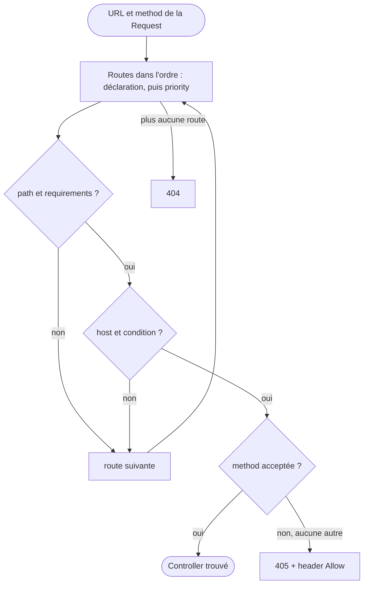

## En une phrase

Le routing fait le lien entre une URL et un controller : il essaie les routes
dans l'ordre, garde la première qui correspond, et sait aussi fabriquer une URL
à partir du nom d'une route.

## L'image de la vie réelle

Pense au **centre de tri de La Poste**. L'adresse sur la lettre, c'est l'URL.
Le trieur lit une liste de règles de haut en bas et envoie la lettre au premier
guichet dont la règle correspond : c'est le **matching**, et la première route
qui correspond gagne. Le format imposé du code postal, c'est un
**requirement** ; « sans étage indiqué, rez-de-chaussée », c'est une **default
value**. Et quand tu écris une adresse, tu la recopies depuis ton carnet plutôt
que de la taper au hasard : c'est la **génération d'URL** à partir du nom de la
route.

## Le schéma

## Notion par notion

### Routing component and FrameworkBundle

**C'est quoi ?** Le component Routing associe une Request à des variables —
dont `_controller` — et sait générer des URL. FrameworkBundle le câble dans
l'application.

**Dans la vraie vie** Le centre de tri (le component) peut fonctionner dans
n'importe quelle ville ; le bureau de poste local (le bundle) le branche à ses
guichets.

**Pour l'examen** Apparier et générer sont deux classes distinctes,
`UrlMatcher` et `UrlGenerator`. Aucune route ne correspond : 404 ; le path
correspond mais pas la method : 405, avec le header `Allow`.

### Configuration (YAML and PHP attributes)

**C'est quoi ?** Une route se déclare par l'attribute `#[Route]` sur le
controller, ou dans un file YAML.

**Dans la vraie vie** Une règle de tri écrite sur le guichet lui-même, ou dans
le classeur central : même règle, deux endroits pour l'écrire.

**Pour l'examen** Les routes sont essayées dans l'ordre et la **première** qui
correspond gagne, jamais « la plus précise ». L'option `priority` n'existe
qu'en attribute. Une key YAML inconnue fait échouer le chargement.

### Restrict URL parameters

**C'est quoi ?** Un requirement : une expression régulière que la valeur d'un
parameter doit respecter pour que la route corresponde.

**Dans la vraie vie** Le code postal doit avoir cinq chiffres : une lettre
avec « ABCDE » ne part pas dans cette case.

**Pour l'examen** Un requirement départage `/blog/{page}` et `/blog/{slug}`
sans dépendre de l'ordre. Il s'écrit en option, inline (`{page<[0-9]+>}`) ou avec
l'enum `Requirement`, et il est aussi vérifié quand on génère une URL.

### Set default values to URL parameters

**C'est quoi ?** Une default value rend un parameter facultatif dans l'URL.

**Dans la vraie vie** « Sans numéro d'étage, on livre au rez-de-chaussée » :
l'adresse reste valable sans préciser l'étage.

**Pour l'examen** En attribute, la default value est celle de l'argument du
controller. Tout ce qui suit un parameter facultatif doit l'être aussi. Une
default value en fin de path disparaît de l'URL générée, sauf avec
`{!page}`.

### URLs generation

**C'est quoi ?** Fabriquer une URL à partir du nom d'une route et de ses
parameters, au lieu de l'écrire à la main.

**Dans la vraie vie** Tu choisis « Maman » dans ton carnet d'adresses au lieu de
retaper son adresse : si elle déménage, le carnet suit.

**Pour l'examen** `generateUrl()` dans un controller, `path()` et `url()` en
Twig. Par défaut on obtient un path absolu, `url()` donne l'URL complète. Un
parameter que la route ne connaît pas part dans la query string, sans erreur.

### Trigger redirects

**C'est quoi ?** Les redirects que le routing fait tout seul : la barre
oblique finale en trop ou en moins, et le schéma (`https`) exigé par la route.

**Dans la vraie vie** Le facteur corrige « rue Victor Hugo » en « rue
Victor-Hugo » et te fait suivre le courrier, sans rien te demander.

**Pour l'examen** Ces redirects sont toujours des 301, et seulement en `GET`
et `HEAD` : un `POST` sur la mauvaise forme d'URL reçoit un 404.

### Special internal routing attributes

**C'est quoi ?** Cinq parameters réservés, préfixés d'un souligné : `_controller`,
`_format`, `_locale`, `_fragment`, `_query`.

**Dans la vraie vie** Les cachets officiels sur la lettre : « urgent »,
« en anglais », « à remettre en main propre ». Ils ne font pas partie de
l'adresse, ils disent comment traiter la lettre.

**Pour l'examen** `_format` fixe le `Content-Type` seulement s'il manque.
`_query` n'agit qu'à la génération d'URL. `#[Route]` a des arguments courts
`locale` et `format`.

### Domain name matching

**C'est quoi ?** L'option `host` : la route ne correspond que pour un nom de
domaine donné, qui peut contenir des parameters.

**Dans la vraie vie** Deux bureaux de poste dans deux villes : la même rue
existe dans les deux, mais la lettre va au bureau de la bonne ville.

**Pour l'examen** Sans `host`, tout domain correspond. La comparaison ignore
la casse. Une default value de host ne sert qu'à générer une URL : elle ne
rend pas le host facultatif.

### Conditional request matching

**C'est quoi ?** L'option `condition` : une expression ExpressionLanguage qui
doit être vraie pour que la route corresponde.

**Dans la vraie vie** « Ce guichet ne prend que les colis lourds » : si le
colis est léger, ce guichet n'existe pas pour lui.

**Pour l'examen** Une condition fausse efface la route : ni 405 ni redirect,
on passe à la suivante. Elle voit `request`, `context` et `params`, et elle est
ignorée quand on génère une URL.

### HTTP methods matching

**C'est quoi ?** L'option `methods` : la route n'accepte que certains verbes
HTTP.

**Dans la vraie vie** Le guichet « lettres » et le guichet « colis » : même
adresse, mais pas le même envoi.

**Pour l'examen** Sans `methods`, tous les verbes passent ; `GET` accepte aussi
`HEAD`. Un form HTML simule `PUT` ou `DELETE` avec le field caché `_method`,
lu seulement si `http_method_override` est activé — désactivé par défaut.

### User's locale guessing

**C'est quoi ?** Comment Symfony choisit la langue de la Request : depuis l'URL
d'abord.

**Dans la vraie vie** Une lettre adressée à « Bruxelles, quartier
néerlandophone » : la langue est dans l'adresse ; sinon, on regarde la langue
de l'auteur ; sinon, on répond en français.

**Pour l'examen** Le parameter `_locale` du path décide ; sinon
`Accept-Language`, seulement si on l'a activé ; sinon `default_locale`. Changer
la locale dans un controller arrive trop tard pour le reste de la Request.

### Router debugging

**C'est quoi ?** Deux commands : `debug:router` liste les routes, `router:match`
dit quelle route répond à un path.

**Dans la vraie vie** Imprimer la liste des règles de tri, puis tester : « cette
adresse, elle part où ? ».

**Pour l'examen** `debug:router` affiche les routes dans l'ordre où Symfony les
essaie. `router:match` rejoue un path, en `GET` sur `localhost` par défaut, et
explique les routes qui « correspondent presque ».

## Les erreurs de débutant

- Croire que la route la plus précise gagne : c'est la première qui
  correspond.
- Écrire les URL à la main dans les templates au lieu de `path()`.
- Penser qu'une condition fausse donne un 405.
- Attendre que le field `_method` marche sans activer `http_method_override`.
- Changer la locale dans le controller et s'étonner que rien ne suive.

## La fiche du lot

- **Première route qui correspond gagne**, `priority` en attribute.
- **Requirement** = regex, aussi vérifié à la génération.
- **Default value** = parameter facultatif.
- **`path()`** = path absolu, **`url()`** = URL complète.
- Redirects du routing : **301**, `GET` et `HEAD` seulement.
- **Condition fausse** = route effacée, pas de 405.
- Sans **`methods`** : tous les verbes ; `GET` inclut **`HEAD`**.
- Locale : **`_locale`**, puis `Accept-Language` si activé, puis
  `default_locale`.
