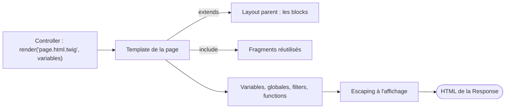

## En une phrase

Twig est le langage des templates de Symfony : on écrit le HTML une fois, avec
des trous que le controller remplit, et Twig se charge de l'escaping, de
l'inheritance entre pages, des translations et des URL.

## L'image de la vie réelle

Pense à une **lettre type avec des trous**, comme celles qu'envoie une banque :
« Bonjour ____, votre solde est de ____ ». Le template, c'est la lettre ; les
variables, ce sont les trous ; le controller fournit les valeurs. Le papier à
header commun à toutes les lettres, c'est l'**inheritance** (`extends`) ; le
paragraphe tout prêt qu'on colle dans plusieurs lettres, c'est l'**include**.
Et avant l'envoi, un employé vérifie qu'aucun texte reçu ne contient de piège :
c'est l'**auto escaping**.

## Le schéma

## Notion par notion

### TwigBundle

**C'est quoi ?** Le bundle qui branche Twig dans Symfony : où se trouvent les
templates, comment surcharger ceux d'un bundle, et les options de
`config/packages/twig.yaml`.

**Dans la vraie vie** L'imprimerie (Twig) installée dans les locaux de
l'entreprise (Symfony) : le bundle dit dans quelle armoire ranger les modèles
de lettres.

**Pour l'examen** Un template de bundle se surcharge dans
`templates/bundles/AcmeBlogBundle/`, et `@!AcmeBlog` désigne l'original.
`strict_variables` suit le mode debug : en dev, une variable inconnue lève une
erreur.

### Twig syntax up to 3.22 version

**C'est quoi ?** Les trois délimiteurs et les operators de Twig : `{{ }}`
affiche, `` exécute, `{# #}` commente.

**Dans la vraie vie** Dans un livre de cuisine, il y a ce qu'on sert (`{{ }}`), les
gestes à faire (``) et les notes en marge (`{# #}`).

**Pour l'examen** `foo.bar` cherche d'abord une key d'array, puis une property,
puis une constant, puis une method. `~` concatène des strings ; `?:` teste si une valeur est
vraie, `??` si elle existe.

### Auto escaping

**C'est quoi ?** Twig échappe automatiquement ce qu'il affiche, pour qu'une
donnée ne puisse pas injecter du script (une faille XSS).

**Dans la vraie vie** Le service courrier qui passe chaque colis aux rayons X :
même un colis d'un ami est contrôlé, par prudence.

**Pour l'examen** La strategy dépend de l'extension du template : `.html`
échappe pour HTML, `.js` pour JavaScript, `.txt` n'échappe rien. Le filter
`raw` doit être le dernier filter de la série, sinon il est sans effet.

### Template inheritance

**C'est quoi ?** Un template parent déclare la structure commune avec des
blocks ; chaque page l'étend avec `extends` et remplit les blocks qu'elle
veut.

**Dans la vraie vie** Le papier à lettres imprimé : logo et pied de page sont là
d'avance, chaque lettre remplit seulement le texte du milieu.

**Pour l'examen** Un seul parent par template. Du contenu hors block dans une
page enfant est une erreur de syntaxe, sauf des blancs ou un `set`.
`parent()` reprend le contenu du block parent au lieu de le remplacer.

### Global variables

**C'est quoi ?** Des variables disponibles dans tous les templates, en plus de
celles passées par le controller. Symfony fournit `app`.

**Dans la vraie vie** Les informations de l'entreprise — nom, adresse —
imprimées sur toutes les lettres sans qu'on les fournisse à chaque fois.

**Pour l'examen** `app` donne accès à `app.user`, `app.request`,
`app.session`, `app.flashes`. Lire `app.flashes` consomme les messages. Une
variable du contexte masque une globale de même nom.

### Filters and functions

**C'est quoi ?** Un filter transforme une valeur (`|upper`), une function en
produit une (`date()`), un test vérifie (`is empty`).

**Dans la vraie vie** Une chaîne de machines : la pomme passe dans la laveuse,
puis l'éplucheuse, puis la découpeuse, dans cet ordre.

**Pour l'examen** Les filters s'appliquent de gauche à droite, et l'ordre peut
changer le résultat. Le filter colle à ce qui le précède immédiatement :
`-1|abs` vaut encore `-1`. Il n'y a pas de filter `truncate` dans le cœur de
Twig.

### Template includes

**C'est quoi ?** Insérer un fragment de template dans un autre : `include` tel
quel, `embed` en redéfinissant certains de ses blocks.

**Dans la vraie vie** Le paragraphe juridique tout prêt qu'on colle au bas de
plusieurs contrats.

**Pour l'examen** Le fragment voit par défaut toutes les variables de
l'appelant ; `only` le limite à ce qu'on lui passe. Rien de ce que le fragment
définit ne remonte vers l'appelant.

### Loops and conditions

**C'est quoi ?** `for` parcourt une liste, avec une clause `else` pour la liste
vide ; `if` teste une condition.

**Dans la vraie vie** Une facture : une ligne par article acheté, et « aucun
article » si le panier est vide.

**Pour l'examen** `loop.index` commence à 1. Il n'y a ni `break` ni
`continue` : on filtre la liste avant la loop. Une variable créée dans la
loop est perdue après elle.

### URLs generation

**C'est quoi ?** `path()` et `url()` fabriquent une URL à partir d'un route
name, comme dans un controller.

**Dans la vraie vie** Le carnet d'adresses de l'entreprise : on choisit le
contact, l'adresse s'écrit toute seule et reste juste s'il déménage.

**Pour l'examen** `path()` rend un path, `url()` une URL complète. Un parameter
que la route ne connaît pas part en query string. Une URL ne s'écrit jamais à
la main dans un template.

### Controller rendering

**C'est quoi ?** `render(controller(…))` exécute un autre controller depuis un
template et insère son HTML, par exemple pour une barre latérale.

**Dans la vraie vie** Demander à un autre service d'écrire un encadré pour ta
lettre : il fait tout son travail à part, puis te le donne.

**Pour l'examen** Chaque appel est une sub-Request complète : ce n'est pas
gratuit. `{{ controller(…) }}` seul fait échouer le rendu : il faut `render()`
autour.

### Translations and pluralization

**C'est quoi ?** Traduire un texte dans un template, avec le filter `|trans`,
le tag `` ou la function `t()`.

**Dans la vraie vie** La même lettre envoyée en français à Paris et en anglais
à Londres, avec « 1 colis » ou « 3 colis » selon le cas.

**Pour l'examen** Le filter échappe son output, le tag non. Les plurals
utilisent ICU MessageFormat, dans un catalogue dont le nom porte le suffixe
`+intl-icu`.

### String interpolation

**C'est quoi ?** Insérer une expression dans une string avec `#{…}`.

**Dans la vraie vie** Une phrase à trous qu'on complète au dernier moment :
« Bonjour #{prénom} ».

**Pour l'examen** L'interpolation ne marche qu'entre guillemets doubles ; entre
guillemets simples, `#{…}` reste du texte. Une string interpolée est échappée
en entier.

### Assets management

**C'est quoi ?** `asset()` transforme le path d'un file de `public/` en URL,
avec le préfixe de l'application et la version configurée.

**Dans la vraie vie** La photothèque qui te donne la photo avec sa mention
« version du 3 mars », pour que personne n'affiche l'ancienne.

**Pour l'examen** Le path s'écrit relatif à `public/`, sans barre au début :
avec une barre, le préfixe de base est perdu. Une URL complète est rendue
telle quelle.

### Debugging variables

**C'est quoi ?** `dump` affiche le contenu d'une variable : en function dans la
page, en tag dans la barre de debug.

**Dans la vraie vie** La loupe du correcteur : on s'en sert pendant la
relecture, jamais sur la lettre envoyée au client.

**Pour l'examen** `dump` vient de DebugBundle, actif en dev et test. Sans
argument, il affiche tout le contexte. Un `dump()` oublié dans un template fait
échouer la compilation en production.

## Les erreurs de débutant

- Écrire `|raw|upper` en croyant désactiver l'escaping : `raw` doit être en
  dernier.
- Mettre du contenu hors block dans une page qui fait `extends`.
- Chercher `break` dans une loop Twig.
- Utiliser des guillemets simples pour une interpolation.
- Laisser un `dump()` dans un template qui part en production.

## La fiche du lot

- **`{{ }}`** affiche, **``** exécute, **`{# #}`** commente.
- Escaping **automatique**, selon l'extension du template.
- **`extends`** + **blocks** ; un seul parent.
- **`include`** voit le contexte, **`only`** le limite.
- Filters **de gauche à droite** ; `raw` en dernier.
- **`path()`** = path, **`url()`** = URL complète.
- **`#{…}`** seulement entre guillemets doubles.
- **`dump`** : DebugBundle, dev et test seulement.
