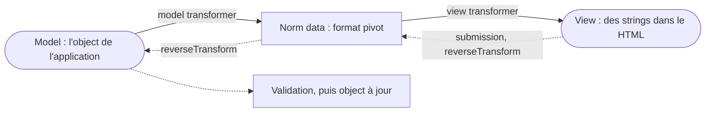

## En une phrase

Le component Form transforme ce que le user tape — du texte — en données
de l'application, et inversement : on décrit les fields une fois, Symfony les
affiche, lit la submission, protège contre le CSRF et met l'object à jour.

## L'image de la vie réelle

Imagine le **guichet d'une mairie**. Tu remplis une fiche papier à la main :
ce ne sont que des lettres et des chiffres écrits au stylo (la **view**).
L'agent les recopie dans le registre officiel, avec de vraies dates et de vrais
montants (le **model**). Entre les deux, il vérifie et convertit — « 12/03 »
devient une date : ce sont les **data transformers**. Le ticket numéroté qui
prouve que tu as fait la queue à ce guichet-là, c'est le **token CSRF**. Et la
mise en page de la fiche — cases, couleurs, police — c'est le **theme**.

## Le schéma

## Notion par notion

### Form component

**C'est quoi ?** Le component qui convertit des données entre trois couches :
**model** (le format de l'application), **normalized** (un format pivot) et
**view** (des strings dans la page).

**Dans la vraie vie** La fiche papier (view), la note de travail de l'agent
(normalized) et le registre officiel (model).

**Pour l'examen** La view n'est faite que de strings. Le component est
autonome : il s'utilise sans FrameworkBundle.

### Forms creation

**C'est quoi ?** Décrire un form, de préférence dans une class de type, en
ajoutant des fields avec `add()`.

**Dans la vraie vie** Le modèle de fiche imprimé une fois pour toutes, au lieu
de redessiner la fiche à chaque visiteur.

**Pour l'examen** Le nom du field relie le field à la property du même nom.
`data_class` dit quelle class le form remplit. Un field qui ne correspond à
aucune property se déclare `mapped: false`.

### Forms handling

**C'est quoi ?** Traiter la submission dans le controller : `handleRequest()`,
puis vérifier `isSubmitted()` et `isValid()`.

**Dans la vraie vie** L'agent ne traite que les fiches déposées à son guichet ;
si la fiche est complète, il te renvoie vers la porte, sinon il te la rend
avec les erreurs entourées.

**Pour l'examen** `handleRequest()` ne soumet le form que si la Request lui est
destinée. On teste `isSubmitted()` avant `isValid()`. Après la submission,
l'object est déjà modifié. Un form soumis et invalide rendu par `render()`
reçoit un statut 422.

### Form types (built-in and custom)

**C'est quoi ?** Chaque form, et chaque field, est un type. Un type se
réutilise en le spécialisant (`getParent()`), en l'imbriquant (`add()`) ou en
le répétant (`CollectionType`).

**Dans la vraie vie** Une case « date » pré-imprimée, une case « adresse »
faite de quatre petites cases, et une liste « enfants » où l'on ajoute une
ligne par enfant.

**Pour l'examen** Spécialiser hérite d'un type et change ses options ;
composer imbrique ses données. Avec `CollectionType`, `allow_add` et
`allow_delete` autorisent l'ajout et le retrait, et `by_reference: false` fait
appeler l'adder de l'object.

### Forms rendering with Twig

**C'est quoi ?** Afficher un form dans Twig : tout d'un coup avec `form()`,
ligne par ligne avec `form_row()`, ou pièce par pièce.

**Dans la vraie vie** Imprimer la fiche entière, ou recopier les questions une
à une sur ton propre papier — à condition de ne pas en oublier.

**Pour l'examen** `form_end()` affiche les fields oubliés, dont le token CSRF.
Un field ne s'affiche qu'une fois. Les functions prennent `form.champ`, jamais
le nom en string.

### Forms theming

**C'est quoi ?** Changer l'apparence des forms en redéfinissant des blocks
Twig.

**Dans la vraie vie** Changer la mise en page de toutes les fiches de la mairie
d'un coup, ou seulement de la case « téléphone » d'une fiche.

**Pour l'examen** Pour chaque field, Twig cherche le block du plus précis au
plus général. Dans la liste des themes, le dernier déclaré gagne.

### CSRF protection

**C'est quoi ?** Un field caché `_token` que Symfony pose dans le form et
vérifie à la submission, pour qu'un autre site ne puisse pas soumettre le form
à ta place.

**Dans la vraie vie** Le ticket numéroté du guichet : une fiche apportée par
quelqu'un qui n'a pas pris de ticket ici est refusée.

**Pour l'examen** Sans token valide, le form est soumis mais invalide, sans une
ligne de code. Les tokens avec état vivent en session, les tokens sans état se
vérifient par les headers `Origin` et `Referer`.

### Handling file upload

**C'est quoi ?** Recevoir un file par un field `FileType`, le déplacer, et
garder son nom sur l'entité.

**Dans la vraie vie** Tu déposes une photo avec ta fiche : l'agent la range
dans un classeur et note seulement « photo n°125 » dans le registre.

**Pour l'examen** Le field `FileType` se déclare `mapped: false` : l'entité
stocke un nom, pas le file. Le controller lit le file sur le form, teste qu'il
n'est pas `null`, puis le déplace.

### Built-in form types

**C'est quoi ?** La quarantaine de types fournis : texte, nombres, dates,
choix, `RepeatedType`, boutons…

**Dans la vraie vie** Le catalogue des cases à imprimer : checkbox, menu
déroulant, double case « password / confirmation ».

**Pour l'examen** Avec `ChoiceType`, `multiple` et `expanded` donnent un
select, des radio buttons ou des checkboxes. Dans `choices`, la key est le
libellé affiché et la valeur est la donnée. `RepeatedType` affiche deux fields
pour une seule donnée.

### Data transformers

**C'est quoi ?** Une class qui convertit une valeur dans les deux sens :
`transform()` vers la vue, `reverseTransform()` au retour de la submission.

**Dans la vraie vie** L'agent qui lit « 12 mars » sur la fiche et écrit une
vraie date dans le registre — et l'inverse quand il te réimprime la fiche.

**Pour l'examen** Une saisie impossible se signale par
`TransformationFailedException` : le field devient invalide avec un message,
la page ne plante pas. Une autre exception, elle, remonte.

### Form events

**C'est quoi ?** Cinq moments où l'on peut intervenir sur un form :
`PRE_SET_DATA`, `POST_SET_DATA`, `PRE_SUBMIT`, `SUBMIT`, `POST_SUBMIT`.

**Dans la vraie vie** « Si vous avez coché “marié”, ajoutez le nom du
conjoint » : la fiche s'adapte selon ce que tu as déjà répondu.

**Pour l'examen** Dans `PRE_SET_DATA`, la donnée se lit sur l'event. On peut
encore ajouter un field jusqu'à `PRE_SUBMIT`. La validation a lieu au
`POST_SUBMIT` du form racine.

### Form type extensions

**C'est quoi ?** Une class qui modifie un type existant partout dans
l'application, sans toucher aux forms.

**Dans la vraie vie** Le cachet « Confidentiel » ajouté d'office sur toutes les
fiches d'un même modèle.

**Pour l'examen** Un type crée un field, une extension modifie ceux qui
existent. Elle atteint les descendants du type : étendre `TextType` touche
`EmailType`, pas `IntegerType`. Étendre `FormType` touche tous les fields, mais
pas les boutons.

### Form options (OptionsResolver component)

**C'est quoi ?** Le component qui déclare les options permises d'un type :
lesquelles existent, leurs défauts, leurs types et valeurs acceptés.

**Dans la vraie vie** La liste des réglages d'un appareil : un bouton qui
n'existe pas ne peut pas être tourné, et l'appareil le dit tout de suite.

**Pour l'examen** Une option inconnue lève une exception qui liste les options
valides. `setDefaults()` donne des default values, `setRequired()` rend une
option obligatoire. C'est ce qu'on écrit dans `configureOptions()`.

## Les erreurs de débutant

- Appeler `isValid()` avant `isSubmitted()`.
- Mapper un `FileType` directement sur une property de l'entité.
- Oublier `form_end()` et perdre le token CSRF.
- Croire qu'une extension de `TextType` touche aussi `IntegerType`.
- Croire que le premier theme déclaré gagne : c'est le dernier.

## La fiche du lot

- Trois couches : **model**, **normalized**, **view** (des strings).
- **`handleRequest()`**, puis **`isSubmitted()`** avant **`isValid()`**.
- Le nom du field = la **property**.
- **`form_end()`** rend le reste, token compris.
- CSRF absent : **soumis mais invalide**.
- **`FileType`** : `mapped: false`.
- Transformer : **`transform()`** aller, **`reverseTransform()`** retour.
- Extension : les **descendants** du type, pas les frères.
