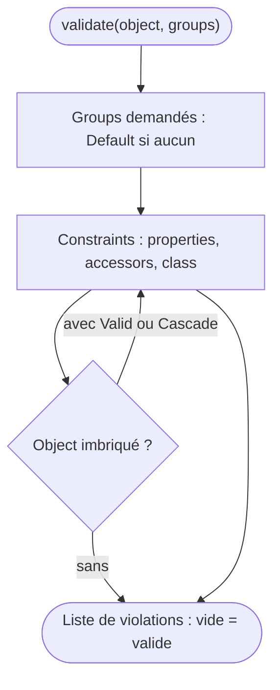

## En une phrase

Le Validator vérifie qu'un object respecte des règles — les constraints — et
rend la liste de ce qui ne va pas, sans jamais lever d'exception pour une
donnée simplement invalide.

## L'image de la vie réelle

Pense au **contrôle technique d'une voiture**. L'inspecteur suit une liste de
points : freins, pneus, phares. Chaque point est une **constraint**. À la fin,
il ne te dit pas « oui » ou « non » : il te remet la **liste des défauts**
trouvés, vide si tout va bien. Il contrôle certains points sur la voiture
entière (une constraint de **class**), d'autres pièce par pièce (une
**property**). Pour une voiture de collection, on ne contrôle qu'une partie des
points : c'est un **group**. Et on peut décider de faire d'abord les points
rapides, et seulement s'ils sont bons, les points longs : c'est une **group
sequence**.

## Le schéma

## Notion par notion

### Validator component

**C'est quoi ?** Le component qui confronte une valeur à des constraints et
rend une liste de violations.

**Dans la vraie vie** L'inspecteur te remet un rapport, même vide ;
il ne crie pas et ne casse rien quand un phare est grillé.

**Pour l'examen** `validate()` rend toujours une liste : on teste son nombre
d'éléments, jamais un bool. Une donnée invalide donne une violation ; une
constraint mal configurée, elle, lève une exception.

### PHP object validation

**C'est quoi ?** Déclarer les constraints d'une class, en attributes, YAML,
XML ou PHP.

**Dans la vraie vie** L'inspecteur examine la voiture, mais pas la remorque
accrochée derrière, sauf si on lui dit de la contrôler aussi.

**Pour l'examen** La validation ne descend pas toute seule dans un object
imbriqué : il faut `#[Assert\Valid]` ou `#[Assert\Cascade]`. Les constraints
d'une class parente s'ajoutent à celles de la class enfant.

### Built-in validation constraints

**C'est quoi ?** Le catalogue des constraints fournies : `NotBlank`, `Email`,
`Length`, `Range`, `Choice`, `All`, `Collection`…

**Dans la vraie vie** La liste officielle des points de contrôle : on ne
l'apprend pas par cœur, on apprend à distinguer les points voisins.

**Pour l'examen** `NotBlank` refuse `null`, la string vide, `false` et le
array vide ; `NotNull` ne refuse que `null`. La plupart des autres
constraints laissent passer `null`. En 8.0, elles se configurent par named
arguments.

### Validation scopes

**C'est quoi ?** Les trois endroits où poser une constraint : une property, un
accessor (`get`, `is`, `has`) ou la class entière.

**Dans la vraie vie** Vérifier un pneu (une pièce), vérifier l'usure calculée
d'après le kilométrage (une valeur calculée), ou vérifier que le poids total
respecte la charge maximale (la voiture entière).

**Pour l'examen** La visibilité ne compte jamais. Seule une constraint de class
voit plusieurs properties à la fois : c'est là qu'on compare deux fields.

### Validation groups

**C'est quoi ?** Des noms posés sur les constraints, pour n'en appliquer
qu'une partie selon la situation.

**Dans la vraie vie** Le contrôle « voiture de collection » ne vérifie pas les
mêmes points que le contrôle ordinaire.

**Pour l'examen** Sans group demandé, seul `Default` s'applique. Une
constraint posée dans un group nommé ne fait pas partie de `Default`. Un group
inconnu ne lève rien : il ne sélectionne simplement rien.

### Group sequence

**C'est quoi ?** Valider des groups par étapes, et s'arrêter à la première
étape qui produit une violation.

**Dans la vraie vie** On vérifie d'abord les papiers du véhicule ; s'ils sont
faux, inutile de lancer l'essai sur route, qui coûte cher.

**Pour l'examen** Déclarée sur la class, la séquence remplace `Default`, et
elle se déclare avec le nom de la class. Demander directement un group de la
séquence la contourne.

### Custom callback validators

**C'est quoi ?** La constraint `Callback` fait appeler ta propre method, qui
décide seule des violations.

**Dans la vraie vie** Un point de contrôle maison que le garage ajoute à la
liste officielle, avec son propre critère.

**Pour l'examen** La valeur retournée par la method est ignorée : seule une
violation ajoutée compte. La signature change selon que la method est
d'instance ou statique.

### Violations builder

**C'est quoi ?** Construire une violation détaillée — le field visé, un code,
des parameters — avec `buildViolation()`.

**Dans la vraie vie** Rédiger la ligne du rapport (« pneu avant gauche, usure
trop forte ») puis la signer : sans signature, elle n'entre pas dans le
rapport.

**Pour l'examen** Le builder n'enregistre rien tant qu'on n'appelle pas
`addViolation()` à la fin. `atPath()` rattache l'erreur à un field ; sans lui,
elle se place à la racine.

## Les erreurs de débutant

- Tester le retour de `validate()` comme un bool.
- Croire qu'un object imbriqué est validé sans `Valid` ni `Cascade`.
- Confondre `NotBlank` et `NotNull`.
- Retourner `false` dans un `Callback` en croyant signaler une erreur.
- Oublier `addViolation()` au bout du builder.

## La fiche du lot

- **`validate()`** rend une **liste**, vide = valide.
- Donnée invalide → **violation** ; constraint mal réglée → **exception**.
- Objects imbriqués : **`Valid`** ou **`Cascade`**.
- **`NotBlank`** refuse vide et `null` ; **`NotNull`** seulement `null`.
- Sans group : **`Default`** seul.
- Group sequence : **s'arrête** à la première étape en échec.
- `Callback` : le **retour est ignoré**.
- Builder : rien sans **`addViolation()`**.
