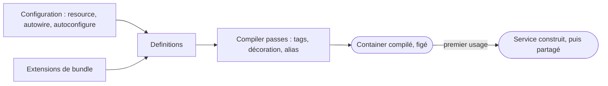

## En une phrase

Une class ne fabrique pas ses outils, elle les reçoit : le service container
connaît le mode de fabrication de chaque service, la compile une fois, et fournit à chacun
ce dont il a besoin, le plus souvent en devinant d'après les types.

## L'image de la vie réelle

Imagine un **restaurant avec une grande cuisine**. Le chef ne va pas forger son
couteau ni construire son four : on les lui **fournit** à son arrivée, c'est
l'**dependency injection**. Le **service container**, c'est l'économe du
restaurant : il a la fiche de chaque ustensile et ne le sort qu'au moment où
quelqu'un en a besoin. La pastille « pâtisserie » collée sur
certains outils, c'est un **tag**. Remplacer le four par un four amélioré qui
garde l'ancien à l'intérieur, c'est une **décoration**. Et chaque matin, avant
l'ouverture, l'économe fige l'inventaire : c'est la **compilation**.

## Le schéma

## Notion par notion

### Dependency Injection component

**C'est quoi ?** Le principe et le component : une class **reçoit** ses
dependencies au lieu de les créer, et le component décrit puis compile les
services.

**Dans la vraie vie** Le chef reçoit ses couteaux en arrivant, au lieu d'aller
en acheter à chaque nouveau client.

**Pour l'examen** Recevoir le container et y piocher n'est pas de l'injection.
Une dependency obligatoire passe par le constructor, une facultative par un
setter. Une référence absente fait échouer la compilation.

### Service container

**C'est quoi ?** L'object qui garde les definitions des services et construit
chacun au premier usage, puis le partage.

**Dans la vraie vie** L'économe : il a la fiche de chaque ustensile, et ne sort
l'ustensile que lorsque quelqu'un le demande.

**Pour l'examen** L'identifier d'un service est par défaut le nom complet de
sa class. Un service est privé par défaut : injectable, mais pas récupérable
par `get()`. Le container est compilé en une class PHP : sans debug, il faut
`cache:clear` après un changement.

### Built-in services

**C'est quoi ?** Les services fournis par les bundles installés, FrameworkBundle
en tête : logger, router, request stack…

**Dans la vraie vie** Le matériel livré avec la cuisine équipée : tu ne l'as
pas acheté pièce par pièce, il vient avec l'installation.

**Pour l'examen** `debug:autowiring` dit quel type écrire pour recevoir un
service. Sans son bundle, ou si sa section est désactivée, le service n'existe
pas. On injecte le type annoncé, souvent une interface.

### Configuration parameters

**C'est quoi ?** Des valeurs nommées : `%nom%` est un parameter,
`%env(NOM)%` une variable d'environment.

**Dans la vraie vie** La température du four est écrite une fois sur la fiche
du matin (le parameter) ; le nombre de couverts, lui, se lit sur l'ardoise au
moment du service (la variable d'environment).

**Pour l'examen** `%nom%` est résolu à la compilation et écrit en dur ;
`%env()%` est lu à l'exécution, et c'est une string sauf processeur. Un
pourcent littéral s'écrit `%%`.

### Services registration (YAML and PHP attributes)

**C'est quoi ?** Comment une class devient un service : on la **découvre**
(`resource`), on la **câble** (`autowire`), on la **configure**
(`autoconfigure`).

**Dans la vraie vie** Le nouvel employé est repéré, reçoit ses outils, puis on
lui donne son badge de poste selon son métier.

**Pour l'examen** Ce sont trois mécanismes distincts. Une déclaration
explicite doit être écrite **sous** la déclaration `App\:`, sinon elle est
remplacée en silence. `_defaults` ne vaut que pour son block.

### Service decoration

**C'est quoi ?** Un service qui prend la place d'un autre sous son identifier,
en gardant l'original à l'intérieur.

**Dans la vraie vie** Mettre une housse isotherme autour du four : les
cuisiniers utilisent toujours « le four », qui fait plus qu'avant.

**Pour l'examen** Les consommateurs reçoivent le decorator sans changer une
ligne ; l'original devient `.inner`. Le decorator doit avoir la même
interface. Plusieurs decorators s'empilent selon leur priority.

### Tags

**C'est quoi ?** Un tag posé sur des services, pour qu'un autre service
les reçoive tous sans les nommer.

**Dans la vraie vie** La pastille « pâtisserie » : le pâtissier prend tous les
ustensiles étiquetés, même ceux achetés après lui.

**Pour l'examen** Un tag ne fait rien tout seul : il faut quelque chose qui le
lise. On reçoit les services tagués avec `#[AutowireIterator]`, de façon lazy,
la priority la plus haute en premier.

### Semantic configuration

**C'est quoi ?** La configuration propre d'un bundle : un arbre qui valide les
keys, et une extension qui en fait des services.

**Dans la vraie vie** La fiche d'un grossiste : elle refuse une case
qui n'existe pas, puis livre ce que tu as coché.

**Pour l'examen** Une key inconnue est une erreur. Tout se passe à la
compilation. Un bundle peut configurer un autre bundle par prepend, et
l'application garde le dernier mot.

### Factories

**C'est quoi ?** Au lieu de `new`, le container appelle une method ou une
function qui fabrique le service.

**Dans la vraie vie** Acheter son pain chez le boulanger au lieu de le faire
soi-même : le container va chercher, il ne pétrit pas.

**Pour l'examen** Les `arguments` vont à la factory, et c'est la valeur
retournée qui devient le service. Sans `@`, la method est statique ; avec `@`,
c'est la method d'un service.

### Compiler passes

**C'est quoi ?** Du code qui modifie le container pendant sa compilation, en
travaillant sur les definitions.

**Dans la vraie vie** L'inspection du matin avant l'ouverture : on range, on
marque, on remplace un outil, puis l'inventaire est figé.

**Pour l'examen** Une passe manipule des definitions, jamais des objects, et ne
tourne qu'une fois. Par défaut elle passe avant l'optimisation, avec la
priority 0. On l'utilise pour les services des autres ; pour les tiens, la
configuration suffit.

### Services autowiring

**C'est quoi ?** Le container remplit un argument d'après son **type**.

**Dans la vraie vie** Le chef demande « un couteau à pain », pas « le couteau
n°12 » : l'économe trouve l'outil qui correspond.

**Pour l'examen** Une interface est injectée automatiquement s'il n'en existe
qu'une implémentation ; au-delà, on choisit par un alias ou `#[Target]`. Un
scalaire ne se devine jamais : `bind` ou `#[Autowire]`.

### Service locators

**C'est quoi ?** Un petit container limité à une liste déclarée de services, qui
ne construit chacun qu'au moment du `get()`.

**Dans la vraie vie** Un tiroir qui contient seulement les dix épices du
plat, sorties une à une quand on en a besoin.

**Pour l'examen** Ce n'est pas le container de l'application : la liste est
déclarée et vérifiée à la compilation, services privés compris. Un service
déclaré avec `?` est facultatif.

## Les erreurs de débutant

- Injecter le container entier dans un service.
- Croire qu'un service est public par défaut.
- Penser qu'un tag agit tout seul.
- Écrire une déclaration explicite au-dessus du `App\:`.
- Attendre de l'autowiring qu'il devine un scalaire.

## La fiche du lot

- On **reçoit** ses dependencies, on ne les crée pas.
- Obligatoire : **constructor** ; facultative : **setter**.
- Service **privé** par défaut, construit au **premier usage**.
- **`%nom%`** à la compilation, **`%env()%`** à l'exécution.
- Decorator : même **identifier**, l'original en **`.inner`**.
- Tag : rien **sans lecteur**.
- Autowiring : **par le type** ; une seule implémentation = alias auto.
- Compiler pass : des **definitions**, une seule fois.
