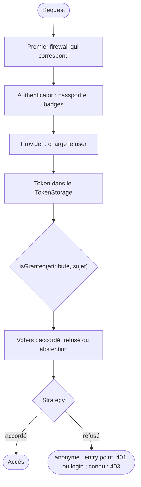

## En une phrase

La security répond à deux questions dans l'ordre : **qui êtes-vous ?**
(l'authentication) puis **avez-vous le droit ?** (l'authorization), avec des
firewalls qui découpent le site en zones, des roles et des voters qui décident.

## L'image de la vie réelle

Pense à un **immeuble de bureaux**. À l'entrée, l'agent d'accueil vérifie ta
pièce d'identité et te donne un **badge** : c'est l'**authentication**, et le
badge est le **token**. Chaque étage a sa propre entrée avec son propre
contrôle : ce sont les **firewalls**. Les portes s'ouvrent selon ce qui est
inscrit sur ton badge — « employé », « direction » : ce sont les **roles**. Pour
une décision plus fine, comme « peut-il entrer dans *ce* bureau-là ? », on
demande à un responsable : c'est un **voter**. Et le registre du personnel où
l'on retrouve ta fiche, c'est le **user provider**.

## Le schéma

## Notion par notion

### Security Core, CSRF and PasswordHasher components

**C'est quoi ?** La security est répartie en plusieurs packages : le hash des
passwords, les tokens CSRF, le modèle (users, tokens, voters, roles), et la
partie HTTP.

**Dans la vraie vie** Le serrurier, l'imprimeur de badges et le service de
sécurité de l'immeuble sont trois métiers : on peut faire appel à l'un sans les
deux autres.

**Pour l'examen** `password-hasher` hache sans rien dépendre du reste.
`security-core` ne connaît pas HTTP. `security-csrf` protège un form sans
firewall. SecurityBundle réunit le tout avec la configuration `security:`.

### Authentication

**C'est quoi ?** Établir **qui** fait la Request, à partir de ses credentials,
et ranger le résultat dans un token.

**Dans la vraie vie** L'accueil vérifie ta carte d'identité et te remet ton
badge ; tant que tu le portes, on sait qui tu es.

**Pour l'examen** Sans user, il n'y a pas de token. Un anonyme refusé passe par
l'entry point — 401, ou redirect vers le login — ; un user connu refusé
reçoit un 403. Avec état, le token est gardé en session ;
avec `stateless: true`, rien n'est gardé.

### Authorization

**C'est quoi ?** Décider si le user a le **droit** de faire une action,
avec `isGranted()`.

**Dans la vraie vie** Ton badge te fait entrer dans l'immeuble, mais la porte de
la salle des serveurs vérifie s'il y est autorisé.

**Pour l'examen** `isGranted()` passe par l'`AccessDecisionManager` : des
voters votent, une strategy tranche — `affirmative` par défaut, un accord
suffit. Si tous les voters s'abstiennent, l'accès est refusé.

### Configuration

**C'est quoi ?** Le file `security.yaml` et ses cinq sections : `hashers`,
`providers`, `firewalls`, `access_control`, `role_hierarchy`.

**Dans la vraie vie** Le règlement intérieur de l'immeuble, lu de haut en bas :
la première règle qui s'applique à ta situation décide.

**Pour l'examen** Dans `firewalls` comme dans `access_control`, c'est la
**première** entrée qui correspond qui s'applique : la plus générale se met en
dernier. Une erreur d'ordre ne produit aucun message.

### Providers

**C'est quoi ?** Le service qui charge le user à partir de son identifier, et
le relit à chaque Request d'un firewall avec état.

**Dans la vraie vie** Le registre du personnel : chaque matin, on vérifie que
ton nom y est encore, et que tes droits n'ont pas changé.

**Pour l'examen** `loadUserByIdentifier()` sert à la connexion,
`refreshUser()` à chaque Request avec état. Un user supprimé redevient
anonyme, sans erreur 500 ; ses roles ou son password changés le
déconnectent.

### Firewalls

**C'est quoi ?** Des zones d'URL qui s'authentifient chacune à leur façon :
outils de dev, API sans session, site avec form de login.

**Dans la vraie vie** Le parking, l'accueil et les étages ont chacun leur
contrôle ; tu ne passes que par un seul à la fois.

**Pour l'examen** Un seul firewall traite une Request : le premier dont le
pattern correspond. Un firewall sans `pattern` attrape tout, donc il se met en
dernier. `security: false` coupe toute la security de la zone.

### Users

**C'est quoi ?** La class qui représente le user, avec ses roles et son
identifier.

**Dans la vraie vie** La fiche du salarié : son nom et ses accréditations. Le
code de son casier est rangé dans un autre dossier.

**Pour l'examen** En 8.0, `UserInterface` n'a que `getRoles()` et
`getUserIdentifier()` ; le password relève d'une autre interface. Un compte
suspendu se refuse dans un user checker.

### Password hashers

**C'est quoi ?** Le service qui transforme un password en hash, choisi selon la
class du user.

**Dans la vraie vie** On ne garde pas le code du coffre, seulement son
empreinte : on vérifie que ton code produit la même empreinte, sans jamais la
stocker.

**Pour l'examen** `auto` hache aujourd'hui en bcrypt et sait vérifier d'autres
algorithmes. `migrate_from` permet de rehacher un ancien format à la connexion,
sans que le user ne voie rien.

### Roles

**C'est quoi ?** Des strings qui décrivent ce qu'un user **est** ; elles
commencent obligatoirement par `ROLE_`.

**Dans la vraie vie** Les mentions sur le badge : « employé », « manager ». Un
manager ouvre aussi les portes des employés : c'est la hiérarchie.

**Pour l'examen** Sans le préfixe `ROLE_`, un role n'est jamais accordé. La
hiérarchie est appliquée par le voter : il faut `isGranted()`, pas un
`in_array()` sur `getRoles()`.

### Access Control Rules

**C'est quoi ?** Les règles de `access_control` qui protègent des URL dans la
configuration.

**Dans la vraie vie** Le panneau à chaque porte : « Réservé à la direction »,
« Accès libre ». On lit les panneaux dans l'ordre, et le premier qui parle de
ta porte décide.

**Pour l'examen** Seule la première règle qui correspond s'applique : on écrit
de la plus précise à la plus générale. Le `path` est une expression régulière
qui ne voit pas la query string.

### Authenticators, Passports and Badges

**C'est quoi ?** L'authenticator lit la Request et monte un dossier, le
passport ; chaque badge du dossier porte une information ou une vérification à
faire.

**Dans la vraie vie** Au guichet, l'agent constitue ton dossier : pièce
d'identité, justificatif, photo. D'autres services vérifient chaque pièce.

**Pour l'examen** L'authenticator ne vérifie rien lui-même : des listeners
contrôlent chaque badge, et un badge non résolu fait échouer la connexion.
`UserBadge` est obligatoire.

### Voters and voting strategies

**C'est quoi ?** Un voter décide sur un **object** précis : « l'auteur peut-il
modifier *son* article ? ». Il accorde, refuse ou s'abstient.

**Dans la vraie vie** Le chef de service qui dit oui ou non pour son bureau, ou
qui répond « ce n'est pas mon bureau » et s'abstient.

**Pour l'examen** `supports()` trie, `voteOnAttribute()` décide. Avec
`affirmative`, un accord suffit ; avec `unanimous`, un refus suffit ; avec
`consensus`, la majorité l'emporte.

## Les erreurs de débutant

- Confondre authentication (qui ?) et authorization (quel droit ?).
- Mettre le firewall sans `pattern` en premier.
- Écrire un role sans le préfixe `ROLE_`.
- Tester un role avec `in_array()` au lieu de `isGranted()`.
- Placer la règle d'accès la plus générale en tête de `access_control`.

## La fiche du lot

- **Authentication** = qui ; **authorization** = quel droit.
- Pas de user, **pas de token**.
- Refus : **entry point** (401 ou login) pour un anonyme, **403** pour un user
  connu.
- Firewalls et `access_control` : **la première** qui correspond.
- Role = **`ROLE_…`** ; hiérarchie par le **voter**.
- Voter : **accordé, refusé ou abstention** ; `affirmative` par défaut.
- Tous abstenus : **refusé**.
- `auto` = **bcrypt** aujourd'hui ; `migrate_from` pour l'ancien.
