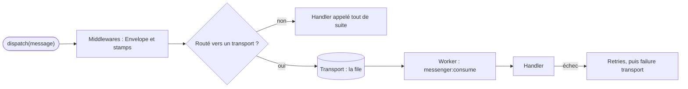

## En une phrase

Messenger permet de **déposer un message** au lieu de faire le travail tout de
suite : selon le routage, il est traité sur place ou envoyé dans une file, où un
worker le prend plus tard, avec des retries si ça échoue.

## L'image de la vie réelle

Pense à un **restaurant avec un passe-plat**. Le serveur ne cuisine pas : il
écrit un bon et le dépose. C'est le **message**, et le déposer, c'est
`dispatch()`. Certains bons sont traités tout de suite au comptoir
(**synchrone**), d'autres sont accrochés sur la barre de la cuisine
(**transport**), où un cuisinier vient les prendre un par un (**worker**). Le
cuisinier qui sait préparer ce plat-là, c'est le **handler**. Chaque bon passe
par une série de mains avant la cuisine — on le tamponne, on vérifie, on note
l'heure : ce sont les **middlewares**. Et un plat raté est refait jusqu'à trois
fois, avant d'aller sur la pile des réclamations : le **failure transport**.

## Le schéma

## Notion par notion

### Messenger component

**C'est quoi ?** Le component qui envoie des messages à des handlers, tout de
suite ou plus tard, à travers un bus.

**Dans la vraie vie** Le serveur dépose un bon au passe-plat et repart servir :
il ne sait pas qui cuisinera, ni quand.

**Pour l'examen** Le code qui dispatche ne change pas selon que le message est
synchrone ou asynchrone : c'est le routage qui décide. Le message voyage dans
une `Envelope` immuable, et le résultat d'un traitement synchrone se lit sur
l'Envelope retournée par `dispatch()`.

### Transports

**C'est quoi ?** Les files où attendent les messages asynchrones, décrites par
un DSN : Doctrine, Redis, AMQP, `in-memory://`…

**Dans la vraie vie** La barre de la cuisine où l'on accroche les bons : une
pour les entrées, une pour les desserts.

**Pour l'examen** Le routage se déclare dans la configuration ou par
`#[AsMessage]`, et la configuration gagne. Un message routé nulle part n'est
pas perdu : il est traité tout de suite.

### Messages and handlers

**C'est quoi ?** Un message est une class ordinaire qui porte des données ; un
handler est une class marquée `#[AsMessageHandler]` qui le traite.

**Dans la vraie vie** Le bon « une pizza margherita », et le pizzaïolo qui sait
la faire.

**Pour l'examen** C'est le **type de l'argument** du handler qui le relie au
message. Si plusieurs handlers acceptent le même message, ils sont tous
appelés. Un message en file a été écrit par l'ancien code : il doit survivre au
deployment.

### Workers

**C'est quoi ?** Un process long, `messenger:consume`, qui lit les files et
appelle les handlers.

**Dans la vraie vie** Le cuisinier de nuit qui prend les bons un par un, et
rentre chez lui après un certain nombre de plats ; le chef d'équipe en appelle
un autre.

**Pour l'examen** Un worker lit ses files dans l'ordre donné : c'est une
priority stricte. Il s'arrête de lui-même sur une limite, et un superviseur le
relance. Après un deployment, `messenger:stop-workers` lui fait prendre le
nouveau code.

### Retries and failures

**C'est quoi ?** Ce qui se passe quand un handler échoue : en synchrone,
l'exception remonte ; dans un worker, le message est rejoué.

**Dans la vraie vie** Le plat brûlé est refait, en attendant un peu plus à
chaque fois ; après trois échecs, le bon part sur la pile des réclamations.

**Pour l'examen** Par défaut, trois retries, avec des délais croissants. Sans
`failure_transport`, un message épuisé est perdu.
`UnrecoverableMessageHandlingException` saute les retries, mais pas la file
d'échec.

### Middleware

**C'est quoi ?** La chaîne de traitements que traverse chaque Envelope avant
l'envoi ou le handler.

**Dans la vraie vie** Les mains par lesquelles passe le bon : on le tamponne, on
note l'heure, on vérifie la table — chacun le passe au suivant.

**Pour l'examen** Un middleware doit appeler le suivant ; s'il ne le fait pas,
tout s'arrête sans erreur. Pour un message asynchrone, il est traversé deux
fois : à l'envoi et à la réception.

### Events

**C'est quoi ?** Les events que Messenger émet, à l'envoi vers un transport et
dans le worker.

**Dans la vraie vie** La sonnette qui retentit quand un bon est accroché, puis
quand un plat sort ou rate.

**Pour l'examen** Un message traité en synchrone, non routé, n'émet aucun event
Messenger. Le worker émet des events au démarrage, à la réception, au succès ou
à l'échec, et à l'arrêt.

## Les erreurs de débutant

- Croire qu'un message non routé est perdu : il est traité tout de suite.
- Oublier `$stack->next()` dans un middleware.
- Lancer des workers sans superviseur ni limite.
- Oublier de configurer un `failure_transport`.
- Ajouter une property promue à un message alors que d'anciens messages
  attendent en file.

## La fiche du lot

- **`dispatch()`** dépose ; le **routage** décide synchrone ou asynchrone.
- Le message voyage dans une **Envelope** immuable.
- Handler relié par le **type de son argument**.
- Configuration > **`#[AsMessage]`** ; non routé = **tout de suite**.
- Worker : **ordre des files** = priority ; arrêt sur une limite.
- Trois **retries** par défaut, puis **failure transport**.
- Middleware : **appeler le suivant**, sinon arrêt muet.
