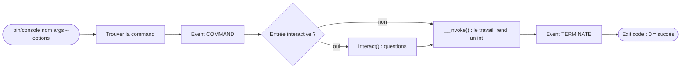

## En une phrase

Le component Console transforme une class PHP en command de terminal : elle
reçoit des arguments et des options, écrit sur l'output, peut poser des
questions, et rend un nombre qui dit si tout s'est bien passé.

## L'image de la vie réelle

Pense à une **télécommande avec des boutons étiquetés**. Chaque bouton est une
**command** (`app:import`, `cache:clear`) ; certains attendent un chiffre à
taper — c'est un **argument** —, d'autres un réglage nommé, comme « volume » —
c'est une **option**. L'écran de la télécommande affiche des messages, plus ou
moins détaillés selon le mode choisi : c'est la **verbosity**. Et après chaque
appui, un voyant vert ou rouge s'allume : c'est l'**exit code**, `0` pour le
succès.

## Le schéma

## Notion par notion

### Console component

**C'est quoi ?** Le component qui fait d'une class PHP une command de terminal.
Il est autonome ; `bin/console` est l'entry point du framework.

**Dans la vraie vie** Le boîtier de la télécommande : il marche avec n'importe
quel appareil, pas seulement celui de la marque.

**Pour l'examen** Une command **retourne un int**, qui devient l'exit code :
`SUCCESS` vaut 0, `FAILURE` 1, `INVALID` 2. Elle ne pose de questions que si
l'entrée est interactive : `-n` ou `-q` les sautent.

### Built-in commands

**C'est quoi ?** Les commands déjà fournies : `list`, `help`, `debug:router`,
`cache:clear`, `lint:twig`…

**Dans la vraie vie** Les boutons d'usine de la télécommande, avant que tu en
programmes de nouveaux.

**Pour l'examen** `bin/console` sans argument exécute `list`. Les familles se
reconnaissent : `debug:*` inspecte, `cache:*` vide, `lint:*` valide. Une
command vise l'environment `dev` par défaut, et un nom s'abrège s'il n'est pas
ambigu.

### Custom commands

**C'est quoi ?** Écrire sa propre command : une class avec `#[AsCommand]` et
une method `__invoke()` qui retourne un int.

**Dans la vraie vie** Programmer un nouveau bouton : tu lui donnes un nom et ce
qu'il doit faire.

**Pour l'examen** En 8.0, la class n'a besoin d'étendre rien. C'est un
service : ses dependencies arrivent par le constructor. Étendre `Command` et
écrire `execute()` reste valide.

### Configuration

**C'est quoi ?** L'identité d'une command — nom, description, aide, alias —
déclarée dans `#[AsCommand]`.

**Dans la vraie vie** L'inscription du bouton et sa notice : on peut lire
l'inscription sans démonter la télécommande.

**Pour l'examen** Seul `name` est obligatoire. Déclarée dans l'attribute, la
description se lit sans construire la class. Dans `'a|b'`, `a` est le nom et
`b` un alias.

### Options and arguments (using PHP attributes)

**C'est quoi ?** Un argument est positionnel (`app:greet Alice`), une option
est nommée (`--iterations=5`). En 8.0, on les déclare avec `#[Argument]` et
`#[Option]` sur les parameters de `__invoke()`.

**Dans la vraie vie** « Canal 5 » est un argument : la place compte. « Volume
à 12 » est une option : on la nomme.

**Pour l'examen** Le mode se déduit de la signature : un argument sans défaut
et non nullable est requis ; une option a toujours une default value et n'est
jamais requise. Un `bool` à `true` par défaut donne `--no-x`.

### Input and Output objects

**C'est quoi ?** La command lit par `InputInterface` et écrit par
`OutputInterface`.

**Dans la vraie vie** On ne parle pas au téléviseur à voix haute : on passe par
la télécommande, qui sait aussi parler à un autre appareil.

**Pour l'examen** Jamais `echo` ni `$argv` : c'est ce qui rend la command
testable. Les messages d'erreur vont sur l'error output, via
`getErrorOutput()`.

### Built-in helpers

**C'est quoi ?** Les outils fournis : questions, progress bar, tables, et
`SymfonyStyle`, qui les réunit.

**Dans la vraie vie** Les menus tout prêts de la télécommande : « Confirmer ? »,
la progress bar du téléchargement.

**Pour l'examen** Sans interaction, une question rend sa default value sans
rien demander. `ConfirmationQuestion` répond oui par défaut. `SymfonyStyle`
est la porte d'entrée recommandée.

### Console events

**C'est quoi ?** Les events dispatchés autour d'une command : avant
(`COMMAND`), en cas d'erreur (`ERROR`), après (`TERMINATE`), à un signal
(`SIGNAL`).

**Dans la vraie vie** Le bip au moment où tu appuies, le voyant rouge en cas de
panne, et le bip de fin.

**Pour l'examen** Sans dispatcher, il n'y a pas d'event. `TERMINATE` a toujours
lieu, et son code est le code final. Un listener de `COMMAND` peut désactiver
la command.

### Verbosity levels

**C'est quoi ?** Le niveau de détail des messages, choisi par le user :
`--silent`, `-q`, normal, `-v`, `-vv`, `-vvv`.

**Dans la vraie vie** Le mode « discret » ou « expert » de l'écran : le même
appareil, plus ou moins bavard.

**Pour l'examen** `--silent` tait même les erreurs, `-q` seulement l'output
normale. Chaque message porte un seuil : il ne s'affiche qu'à partir de ce
niveau.

## Les erreurs de débutant

- Oublier de retourner un int.
- Écrire avec `echo` au lieu de l'output.
- Attendre une question en mode non interactif.
- Rendre une option obligatoire : une option a toujours un défaut.
- Confondre `-q` et `--silent`.

## La fiche du lot

- Command = **class** + **`#[AsCommand]`** + **`__invoke(): int`**.
- **0** succès, **1** échec, **2** invalide.
- Argument **positionnel**, option **nommée**.
- Mode **déduit** du type et du défaut.
- Lire par **Input**, écrire par **Output** ; jamais `echo`.
- Non interactif : la question rend son **défaut**.
- **`TERMINATE`** toujours, son code est le code final.
- `--silent` tait **tout**, `-q` l'output normal.
