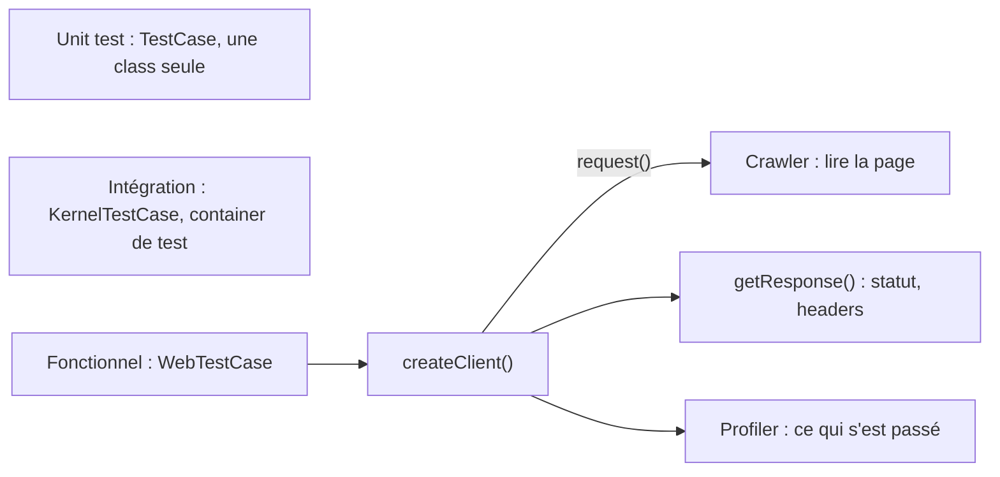

## En une phrase

Tester une application Symfony, c'est vérifier une class seule (unit test), ou
simuler un navigateur qui envoie des Requests à l'application et inspecte les
Responses (functional test), avec des outils pour lire la page, le profiler
et le container.

## L'image de la vie réelle

Pense à la **fabrication d'une voiture**. On teste d'abord chaque pièce seule
sur un banc : le frein, la bougie — ce sont les **unit tests**. Puis on fait
rouler la voiture complète sur une piste d'essai avec un pilote robot qui
appuie sur les pédales et note ce qu'il voit : ce sont les **functional tests**, et le pilote robot, c'est le **client**. Il lit les cadrans de
bord (le **Crawler** lit la page), consulte la boîte noire de la voiture (le
**profiler**), et peut ouvrir le capot pour regarder une pièce précise (le
**container de test**).

## Le schéma

## Notion par notion

### Unit tests with PHPUnit

**C'est quoi ?** Un test PHPUnit ordinaire qui vérifie une class seule, sans
kernel ni container.

**Dans la vraie vie** Tester une bougie sur un banc, sans la monter sur la
voiture.

**Pour l'examen** La documentation distingue trois types de tests : unitaire,
intégration et application. On installe `symfony/test-pack`, on lance
`php bin/phpunit`, et `tests/` reproduit l'arborescence de `src/`.

### Functional tests with PHPUnit

**C'est quoi ?** Un test qui étend `WebTestCase` et fait tourner l'application
entière, dans l'environment `test`.

**Dans la vraie vie** Faire rouler la voiture complète sur la piste d'essai,
toutes les pièces montées.

**Pour l'examen** `createClient()` démarre le kernel. Les assertions de
Symfony, comme `assertResponseIsSuccessful()`, rendent l'échec lisible. En
test, `.env.local` n'est pas lu. Les URL s'écrivent en dur dans un test.

### Client object

**C'est quoi ?** Le `KernelBrowser` rendu par `createClient()` : un navigateur
simulé en mémoire, sans serveur ni JavaScript.

**Dans la vraie vie** Le pilote robot : il appuie sur les pédales, mais ne
comprend pas les écrans tactiles.

**Pour l'examen** `request()` rend un `Crawler`. Le client ne suit pas les
redirects par défaut : `followRedirect()` le fait. Entre deux Requests, le
kernel redémarre.

### Crawler object (CssSelector and DomCrawler components)

**C'est quoi ?** DomCrawler parcourt la page HTML et en extrait des éléments ;
CssSelector traduit un selector CSS en XPath.

**Dans la vraie vie** Lire les cadrans de bord : trouver le compteur de vitesse,
lire sa valeur.

**Pour l'examen** `filter()` a besoin de CssSelector. Chaque method de parcours
rend un nouveau `Crawler`. `text()` ne lit que le premier élément trouvé. Pour
soumettre un form, on part du bouton : `selectButton()->form()`.

### Profiler object (WebProfiler bundle)

**C'est quoi ?** Le profiler, lu depuis un test pour vérifier ce qui s'est
passé pendant une Request : appels à la base de données, durée, emails…

**Dans la vraie vie** La boîte noire de la voiture : elle n'enregistre que si
on l'allume avant le départ.

**Pour l'examen** En test, le profiler est activé mais ne collecte rien.
`enableProfiler()` lance la collecte pour la Request suivante seulement : il
s'appelle avant `request()`.

### Framework objects access

**C'est quoi ?** Atteindre les services depuis un test, par
`static::getContainer()`.

**Dans la vraie vie** Ouvrir le capot pendant l'essai pour regarder ou
remplacer une pièce.

**Pour l'examen** Le container de test atteint aussi les services privés, sauf
ceux supprimés à la compilation. Un kernel neuf démarre à chaque test. Une
doublure se pose avec `set()` avant que le service qui en dépend soit construit.

### Client configuration

**C'est quoi ?** Régler le client : options du kernel et parameters serveur
dans `createClient()`, ou pour une seule Request.

**Dans la vraie vie** Régler le siège et les rétroviseurs pour tout l'essai, ou
changer de pneus pour un seul tour.

**Pour l'examen** Un header s'écrit sous son nom CGI : `HTTP_` suivi du nom en
majuscules, tirets remplacés par des soulignés. Une valeur posée en session
n'est vue par l'application qu'après `save()`.

### Request and response objects introspection

**C'est quoi ?** Relire, après une Request, ce que l'application a vu et
répondu : `getRequest()`, `getResponse()`.

**Dans la vraie vie** Revoir l'enregistrement du tour de piste : ce que le pilote
a fait, ce que la voiture a répondu.

**Pour l'examen** `getRequest()` et `getResponse()` rendent les objects
HttpFoundation de l'application ; les versions `internal` sont celles du
navigateur simulé. Avant toute Request, ces methods lèvent une exception.

### Handling legacy deprecated code

**C'est quoi ?** Repérer et corriger les deprecations avant une mise à jour
majeure.

**Dans la vraie vie** Le voyant « entretien bientôt » : la voiture roule
encore, mais il faut changer la pièce avant le prochain contrôle.

**Pour l'examen** Une deprecation est une notice silencée : rien n'échoue. On la
voit dans la debug toolbar en dev et dans les logs. On corrige toutes les
deprecations sur la dernière mineure, puis on passe à la majeure.

## Les erreurs de débutant

- Croire que le client suit les redirects tout seul.
- Appeler `enableProfiler()` après la Request.
- Attendre que `.env.local` soit lu en test.
- Générer les URL dans un test au lieu de les écrire en dur.
- Croire qu'une deprecation fait échouer le code.

## La fiche du lot

- **Unit** : une class seule ; **fonctionnel** : `WebTestCase` + client.
- **`request()`** rend un **Crawler**.
- Redirects : **pas suivis** par défaut.
- **`text()`** lit le **premier** élément.
- **`enableProfiler()`** avant la Request, pour une seule.
- Container de test : **privés compris**, sauf supprimés.
- Header : **`HTTP_`** + majuscules.
- Deprecation : **silencée**, à corriger avant la majeure.
